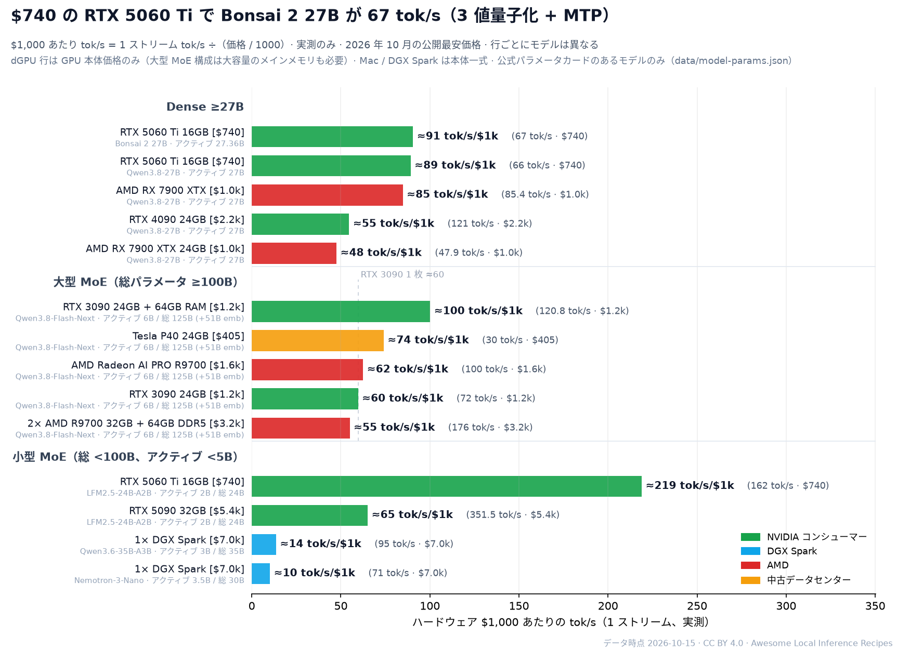
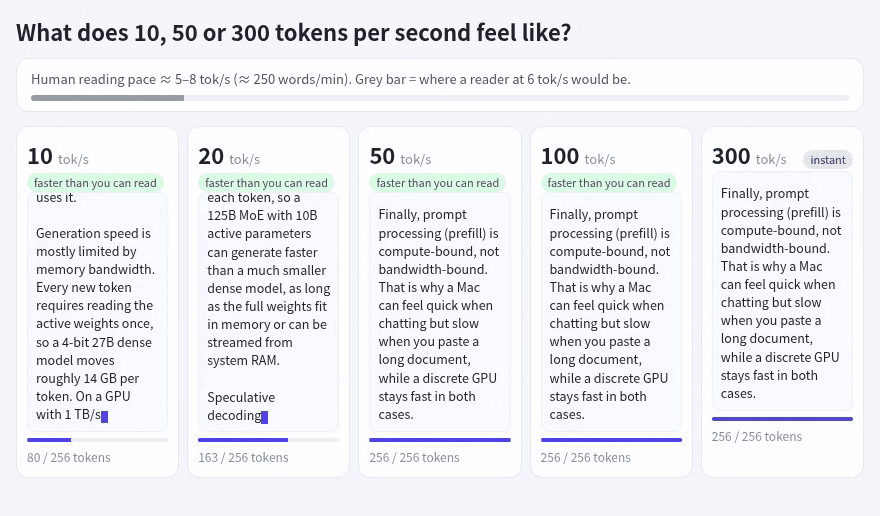
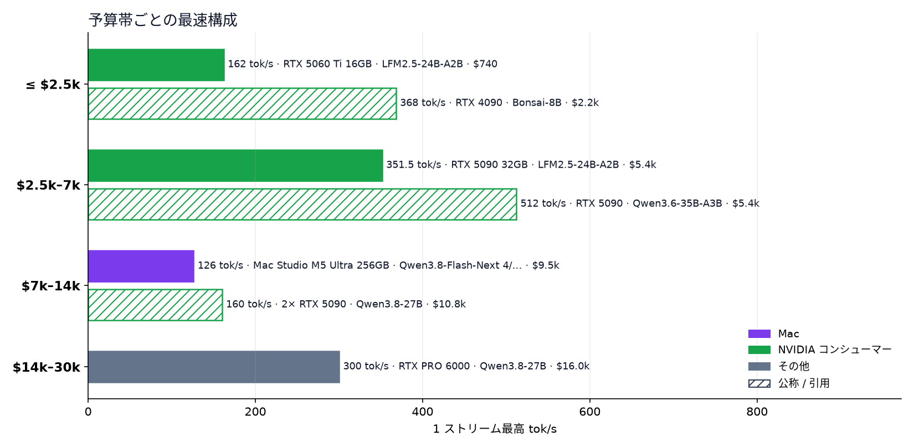

<h1 align="center">ローカル推論レシピ集 </h1>

あなたのハードウェアで、実際どれくらいの速度が出る？出典付きのローカル AI レシピ 353 件。405 ドルの GPU から 3 万ドルの構成まで。

<a href="README.md">English</a> · <a href="README.zh-CN.md">简体中文</a> · <b>日本語</b>

      

<a href="https://raytone-lab.github.io/awesome-local-inference-recipes/explore.html"><b>エクスプローラー</b></a> · <a href="recipes/README.ja.md"><b>レシピガイド</b></a> · <a href="docs/getting-started.ja.md"><b>はじめに</b></a> · <a href="https://raytone-lab.github.io/awesome-local-inference-recipes/submit.html"><b>レシピを投稿</b></a>

### X tok/s ってどれくらい速い？

同じ回答を実際の Qwen3 トークンで 10 / 20 / 50 / 100 / 200 / 500 tok/s（対数間隔）で表示し、黙読の速さ（英語で約 5 tok/s、Brysbaert 2019）やクラウド API の中央値（Artificial Analysis）と比較。 <a href="https://raytone-lab.github.io/awesome-local-inference-recipes/speed.html"><b>インタラクティブ版を試す →</b></a>

**レシピ 353 件**（テキスト 312 · 画像 16 · 動画・音声 25）· **ハードウェア 6 分類** · **エンジン 42 種** · **モデルファミリー 13 系統** · すべての数字に出典リンク · 予算 **3 万ドルまで**

### 注目の記録

| 記録               | モデル · エンジン                      | ハードウェア                                                   | 結果               | 出典                                                                       |
| ---------------- | ------------------------------- | -------------------------------------------------------- | ---------------- | ------------------------------------------------------------------------ |
| Mac で最速          | Qwen3.8-Flash-Next · TensorFold | Mac Studio M3 Ultra · 約 5,649 ドル（ピーク値、最小構成価格、検証機のメモリは不明） | **130 tok/s** ✅  | [出典](https://x.com/ivanfioravanti/status/2104183112611614780)            |
| RTX 5090 1 枚で最速  | Qwen3.8-Flash-Next · Strata     | RTX 5090 + 256GB RAM · 約 5,400 ドル（GPU のみ、256GB RAM 別）    | **176 tok/s** ✅  | [@TechPractice1](https://x.com/TechPractice1/status/2105087037363884483) |
| AMD で最速          | Qwen3.8-Flash-Next · Strata     | AMD Radeon AI PRO R9700 · 約 1,600 ドル                     | **100 tok/s** ✅  | [@TechPractice1](https://x.com/TechPractice1/status/2105338176055509376) |
| 中古データセンター GPU    | Qwen3.8-Flash-Next · Strata     | 2× Tesla V100 32GB PCIe                                  | **120 tok/s** ✅  | [@rewin123](https://x.com/rewin123/status/2108669905616736529)           |
| DGX Spark 1 台で最速 | Qwen3.8-Flash-Next · ExLlama    | 1× DGX Spark · 約 6,950 ドル                                | **71.7 tok/s** ✅ | [出典](https://x.com/yume_arasaki/status/2101741448811229219)              |
| いちばん安い構成         | Qwen3.8-Flash-Next · Strata     | Tesla P40 24GB · 約 405 ドル                                | **30 tok/s** ✅   | [出典](https://github.com/Niko1221/Strata/blob/main/docs/OLDER_GPUS.md)    |

1 ストリームの生成速度で、いずれも出典からの引用です。価格は公開されている最安のハードウェア価格。✅ = 投稿者本人の実測。

## 目次

- [凡例](#凡例)
- [よくある質問](#よくある質問)
- [X で話題のレシピ](#x-で話題のレシピ)
- [モデルファミリー別](#モデルファミリー別)
- [エンジン別](#エンジン別)
- [第 1 段階 · 2,500 ドルまで](#第-1-段階--2500-ドルまで)
- [第 2 段階 · 2,500〜7,000 ドル](#第-2-段階--25007000-ドル)
- [第 3 段階 · 7,000〜14,000 ドル](#第-3-段階--700014000-ドル)
- [第 4 段階 · 14,000〜30,000 ドル](#第-4-段階--1400030000-ドル)
- [価格非公開](#価格非公開)
- [エンジンとツール](#エンジンとツール)
- [関連リスト・ベンチマーク](#関連リストベンチマーク)
- [ライセンス](#ライセンス)

## 凡例

| 出典レベル      | 意味                       | 表記                                                   |
| ---------- | ------------------------ | ---------------------------------------------------- |
| 🏛️ **公式** | 開発元やベンダーが公表した数字          | **モデル** · エンジン `量子化` — ハードウェア → **主要な数字** レベル \[出典\] |
| ✅ **実測**   | 投稿者本人が計測（ログやスクリーンショットあり） | **tok/s** は 1 ストリームの生成速度（プリフィルや合計値は含まない）             |
| 🔁 **伝聞**  | 他人の結果の引用。元の投稿で確認を        | 価格帯は公開されている最安のハードウェア価格（米ドル）で区分                       |
| 📣 **主張**  | 見込み値で、再現条件なし             | 不明な値は推定しません                                          |

## よくある質問

データ時点 2026-10-15。各回答はデータセット中で最速の 1 ストリーム テキスト生成結果で、出典レベルを併記しています。✅ = 投稿者本人の実測。回答ごとにモデルは異なります。

**RTX 5090 1 枚でローカル LLM はどれくらい速い？**  
実測最速：**351.5 tok/s** — LFM2.5-24B-A2B · llama.cpp、RTX 5090 32GB（✅ 実測、2026-10-15、[出典](https://x.com/niklaslenz_ai/status/2110469931011612895)）。このハードウェアのレシピ 35 件、うち実測 14 件。

**RTX 4090 1 枚でローカル LLM はどれくらい速い？**  
実測最速：**121 tok/s** — Qwen3.8-27B · DFlash、RTX 4090 24GB（✅ 実測、日付不明、[出典](https://x.com/yume_arasaki/status/2100595901006008791)）。このハードウェアのレシピ 9 件、うち実測 2 件。

**RTX 3090 1 枚でローカル LLM はどれくらい速い？**  
実測最速：**120.8 tok/s** — Qwen3.8-Flash-Next · Strata、RTX 3090 24GB + 64GB RAM（✅ 実測、日付不明、[出典](https://x.com/needmorevram/status/2105050786938118599)）。このハードウェアのレシピ 10 件、うち実測 3 件。

**Mac Studio M3 Ultra でローカル LLM はどれくらい速い？**  
実測最速：**130 tok/s** — Qwen3.8-Flash-Next · TensorFold、Mac Studio M3 Ultra（✅ 実測、日付不明、[出典](https://x.com/ivanfioravanti/status/2104183112611614780)）。このハードウェアのレシピ 16 件、うち実測 7 件。

**NVIDIA DGX Spark 1 台でローカル LLM はどれくらい速い？**  
実測最速：**95 tok/s** — Qwen3.6-35B-A3B · vLLM、1× DGX Spark（✅ 実測、2026-07-29、[出典](https://x.com/MiaAI_lab/status/2082573590529204458)）。このハードウェアのレシピ 28 件、うち実測 15 件。

**AMD Strix Halo（Ryzen AI Max+ 395）でローカル LLM はどれくらい速い？**  
実測最速：**61 tok/s** — Qwen3.8-Flash-Next · llama.cpp (vahpetr fork)、AMD Strix Halo 128GB（✅ 実測、2026-10-10、[出典](https://github.com/ggml-org/llama.cpp/discussions/30282)）。このハードウェアのレシピ 13 件、うち実測 6 件。

**2,500 ドル以下で実測最速の構成は？**  
実測最速：**162 tok/s** — LFM2.5-24B-A2B · llama.cpp、RTX 5060 Ti 16GB（✅ 実測、2026-10-15、[出典](https://x.com/niklaslenz_ai/status/2110469931011612895)）。この予算内のレシピ 46 件、うち実測 20 件。

## X で話題のレシピ

X で反応が多かったレシピ投稿（いいね + リポスト×3 の順。1 投稿 1 件、「主張のみ」は除外。数値は 2026-10-16 時点）。

- **DeepSeek-V4.1-Flash** — 2× DGX Spark → **29 tok/s** ✅ [@0xSero](https://x.com/0xSero/status/2106373861818224907) ♥2470
- **Qwen3.8-Flash-Next** · vLLM — 1× DGX Spark → **48.7 tok/s** ✅ [@MiaAI_lab](https://x.com/MiaAI_lab/status/2101339268203380857) ♥800
- **GLM-5.3-Flash EXL3 4-bit** · TensorFold — 2× DGX Spark → **60.4 tok/s** ✅ [@MiaAI_lab](https://x.com/MiaAI_lab/status/2105598458547646875) ♥684
- **Ternary Bonsai 2 27B** — RTX 3060 12GB → **50 tok/s** ✅ [@sudoingX](https://x.com/sudoingX/status/2110451458302943383) ♥741
- **Qwen3.8-Flash-Next** · Strata — RTX 5090 32GB → **204 tok/s** ✅ [@niklaslenz_ai](https://x.com/niklaslenz_ai/status/2110132306061013386) ♥487
- **Qwen3.8-Flash-Next** · TensorFold — 1× DGX Spark → **64.4 tok/s** ✅ [@MiaAI_lab](https://x.com/MiaAI_lab/status/2108203605685596490) ♥386
- **DeepSeek-V4-Flash (0731 GA)** — 2× DGX Spark → **82 tok/s** ✅ [@MiaAI_lab](https://x.com/MiaAI_lab/status/2083326111144906836) ♥367
- **Qwen3.8-27B** · vLLM — RTX 5090 32GB → **147 tok/s** ✅ [@MiaAI_lab](https://x.com/MiaAI_lab/status/2088734058842878037) ♥381

## モデルファミリー別

ファミリー名をクリックすると、絞り込み済みのエクスプローラーが開きます。タグ：[`long-context`](https://raytone-lab.github.io/awesome-local-inference-recipes/explore.html?tag=long-context) 118, [`dense`](https://raytone-lab.github.io/awesome-local-inference-recipes/explore.html?tag=dense) 117, [`speculative`](https://raytone-lab.github.io/awesome-local-inference-recipes/explore.html?tag=speculative) 112, [`4bit`](https://raytone-lab.github.io/awesome-local-inference-recipes/explore.html?tag=4bit) 100, [`MTP`](https://raytone-lab.github.io/awesome-local-inference-recipes/explore.html?tag=MTP) 67, [`multi-GPU`](https://raytone-lab.github.io/awesome-local-inference-recipes/explore.html?tag=multi-GPU) 57, [`MoE`](https://raytone-lab.github.io/awesome-local-inference-recipes/explore.html?tag=MoE) 56, [`3bit`](https://raytone-lab.github.io/awesome-local-inference-recipes/explore.html?tag=3bit) 41, [`8bit`](https://raytone-lab.github.io/awesome-local-inference-recipes/explore.html?tag=8bit) 30, [`2bit`](https://raytone-lab.github.io/awesome-local-inference-recipes/explore.html?tag=2bit) 29, [`offload`](https://raytone-lab.github.io/awesome-local-inference-recipes/explore.html?tag=offload) 29, [`ternary`](https://raytone-lab.github.io/awesome-local-inference-recipes/explore.html?tag=ternary) 24, [`1bit`](https://raytone-lab.github.io/awesome-local-inference-recipes/explore.html?tag=1bit) 12, [`few-step`](https://raytone-lab.github.io/awesome-local-inference-recipes/explore.html?tag=few-step) 12, [`bf16`](https://raytone-lab.github.io/awesome-local-inference-recipes/explore.html?tag=bf16) 6, [`6bit`](https://raytone-lab.github.io/awesome-local-inference-recipes/explore.html?tag=6bit) 6, [`abliterated`](https://raytone-lab.github.io/awesome-local-inference-recipes/explore.html?tag=abliterated) 4, [`5bit`](https://raytone-lab.github.io/awesome-local-inference-recipes/explore.html?tag=5bit) 1。

| ファミリー                                                                                                        | レシピ数 | テキスト | 画像  | 動画・音声 |
| ------------------------------------------------------------------------------------------------------------ | ---- | ---- | --- | ----- |
| [Qwen](https://raytone-lab.github.io/awesome-local-inference-recipes/explore.html?family=Qwen)               | 205  | 205  |     |       |
| [Bonsai](https://raytone-lab.github.io/awesome-local-inference-recipes/explore.html?family=Bonsai)           | 30   | 30   |     |       |
| [DeepSeek](https://raytone-lab.github.io/awesome-local-inference-recipes/explore.html?family=DeepSeek)       | 27   | 27   |     |       |
| [GLM](https://raytone-lab.github.io/awesome-local-inference-recipes/explore.html?family=GLM)                 | 25   | 25   |     |       |
| [MiniMax H3](https://raytone-lab.github.io/awesome-local-inference-recipes/explore.html?family=MiniMax%20H3) | 17   |      |     | 17    |
| [Qwen-Image](https://raytone-lab.github.io/awesome-local-inference-recipes/explore.html?family=Qwen-Image)   | 13   |      | 13  |       |
| [LTX](https://raytone-lab.github.io/awesome-local-inference-recipes/explore.html?family=LTX)                 | 4    |      |     | 4     |
| [Z-Image](https://raytone-lab.github.io/awesome-local-inference-recipes/explore.html?family=Z-Image)         | 3    |      | 3   |       |
| [ACE-Step](https://raytone-lab.github.io/awesome-local-inference-recipes/explore.html?family=ACE-Step)       | 2    |      |     | 2     |
| [Edge0](https://raytone-lab.github.io/awesome-local-inference-recipes/explore.html?family=Edge0)             | 2    | 2    |     |       |
| [Gemma](https://raytone-lab.github.io/awesome-local-inference-recipes/explore.html?family=Gemma)             | 2    | 2    |     |       |
| [Wan](https://raytone-lab.github.io/awesome-local-inference-recipes/explore.html?family=Wan)                 | 2    |      |     | 2     |
| [gpt-oss](https://raytone-lab.github.io/awesome-local-inference-recipes/explore.html?family=gpt-oss)         | 1    | 1    |     |       |
| [Other](https://raytone-lab.github.io/awesome-local-inference-recipes/explore.html?family=Other)             | 20   | 20   |     |       |

## エンジン別

エンジン名は表記を統一しています（`scripts/normalize_engines.py`）。元の表記は `engine_note` に残しています。

| エンジン                                                                                                                                                 | レシピ数 |
| ---------------------------------------------------------------------------------------------------------------------------------------------------- | ---- |
| [llama.cpp](https://raytone-lab.github.io/awesome-local-inference-recipes/explore.html?engine=llama.cpp)                                             | 41   |
| [Strata](https://raytone-lab.github.io/awesome-local-inference-recipes/explore.html?engine=Strata)                                                   | 38   |
| [oMLX](https://raytone-lab.github.io/awesome-local-inference-recipes/explore.html?engine=oMLX)                                                       | 30   |
| [TensorFold](https://raytone-lab.github.io/awesome-local-inference-recipes/explore.html?engine=TensorFold)                                           | 22   |
| [vLLM](https://raytone-lab.github.io/awesome-local-inference-recipes/explore.html?engine=vLLM)                                                       | 20   |
| [MLX](https://raytone-lab.github.io/awesome-local-inference-recipes/explore.html?engine=MLX)                                                         | 17   |
| [llama.cpp (PrismML fork)](https://raytone-lab.github.io/awesome-local-inference-recipes/explore.html?engine=llama.cpp%20%28PrismML%20fork%29)       | 14   |
| [ComfyUI](https://raytone-lab.github.io/awesome-local-inference-recipes/explore.html?engine=ComfyUI)                                                 | 12   |
| [MTPLX](https://raytone-lab.github.io/awesome-local-inference-recipes/explore.html?engine=MTPLX)                                                     | 11   |
| [SGLang](https://raytone-lab.github.io/awesome-local-inference-recipes/explore.html?engine=SGLang)                                                   | 11   |
| [DFlash](https://raytone-lab.github.io/awesome-local-inference-recipes/explore.html?engine=DFlash)                                                   | 7    |
| [mlx-serve](https://raytone-lab.github.io/awesome-local-inference-recipes/explore.html?engine=mlx-serve)                                             | 7    |
| [Ollama](https://raytone-lab.github.io/awesome-local-inference-recipes/explore.html?engine=Ollama)                                                   | 5    |
| [Splash](https://raytone-lab.github.io/awesome-local-inference-recipes/explore.html?engine=Splash)                                                   | 5    |
| [Project Maya](https://raytone-lab.github.io/awesome-local-inference-recipes/explore.html?engine=Project%20Maya)                                     | 4    |
| [mirai-s-ada](https://raytone-lab.github.io/awesome-local-inference-recipes/explore.html?engine=mirai-s-ada)                                         | 4    |
| [ExLlama](https://raytone-lab.github.io/awesome-local-inference-recipes/explore.html?engine=ExLlama)                                                 | 3    |
| [Radiance (fork)](https://raytone-lab.github.io/awesome-local-inference-recipes/explore.html?engine=Radiance%20%28fork%29)                           | 3    |
| [ds4 (DwarfStar)](https://raytone-lab.github.io/awesome-local-inference-recipes/explore.html?engine=ds4%20%28DwarfStar%29)                           | 3    |
| [llama.cpp (agentionai fork)](https://raytone-lab.github.io/awesome-local-inference-recipes/explore.html?engine=llama.cpp%20%28agentionai%20fork%29) | 3    |
| [Halogen](https://raytone-lab.github.io/awesome-local-inference-recipes/explore.html?engine=Halogen)                                                 | 2    |
| [MLX Swift](https://raytone-lab.github.io/awesome-local-inference-recipes/explore.html?engine=MLX%20Swift)                                           | 2    |
| [TabbyAPI](https://raytone-lab.github.io/awesome-local-inference-recipes/explore.html?engine=TabbyAPI)                                               | 2    |
| [TandemLLM](https://raytone-lab.github.io/awesome-local-inference-recipes/explore.html?engine=TandemLLM)                                             | 2    |
| [edge0](https://raytone-lab.github.io/awesome-local-inference-recipes/explore.html?engine=edge0)                                                     | 2    |
| [llama.cpp (OpenBMB fork)](https://raytone-lab.github.io/awesome-local-inference-recipes/explore.html?engine=llama.cpp%20%28OpenBMB%20fork%29)       | 2    |
| [ninfer](https://raytone-lab.github.io/awesome-local-inference-recipes/explore.html?engine=ninfer)                                                   | 2    |
| [strata-mlx](https://raytone-lab.github.io/awesome-local-inference-recipes/explore.html?engine=strata-mlx)                                           | 2    |
| [tqLLM](https://raytone-lab.github.io/awesome-local-inference-recipes/explore.html?engine=tqLLM)                                                     | 2    |
| [DS41RT](https://raytone-lab.github.io/awesome-local-inference-recipes/explore.html?engine=DS41RT)                                                   | 1    |
| [FreeToken](https://raytone-lab.github.io/awesome-local-inference-recipes/explore.html?engine=FreeToken)                                             | 1    |
| [Infernix](https://raytone-lab.github.io/awesome-local-inference-recipes/explore.html?engine=Infernix)                                               | 1    |
| [LightX2V](https://raytone-lab.github.io/awesome-local-inference-recipes/explore.html?engine=LightX2V)                                               | 1    |
| [MLX Swift (PrismML fork)](https://raytone-lab.github.io/awesome-local-inference-recipes/explore.html?engine=MLX%20Swift%20%28PrismML%20fork%29)     | 1    |
| [NVIDIA Sol](https://raytone-lab.github.io/awesome-local-inference-recipes/explore.html?engine=NVIDIA%20Sol)                                         | 1    |
| [Osaurus](https://raytone-lab.github.io/awesome-local-inference-recipes/explore.html?engine=Osaurus)                                                 | 1    |
| [gbx](https://raytone-lab.github.io/awesome-local-inference-recipes/explore.html?engine=gbx)                                                         | 1    |
| [llama.cpp (mirai-s fork)](https://raytone-lab.github.io/awesome-local-inference-recipes/explore.html?engine=llama.cpp%20%28mirai-s%20fork%29)       | 1    |
| [llama.cpp (vahpetr fork)](https://raytone-lab.github.io/awesome-local-inference-recipes/explore.html?engine=llama.cpp%20%28vahpetr%20fork%29)       | 1    |
| [mflux](https://raytone-lab.github.io/awesome-local-inference-recipes/explore.html?engine=mflux)                                                     | 1    |
| [sparkinfer](https://raytone-lab.github.io/awesome-local-inference-recipes/explore.html?engine=sparkinfer)                                           | 1    |
| [sushi](https://raytone-lab.github.io/awesome-local-inference-recipes/explore.html?engine=sushi)                                                     | 1    |
| [Unspecified](https://raytone-lab.github.io/awesome-local-inference-recipes/explore.html?engine=Unspecified)                                         | 62   |

## 第 1 段階 · 2,500 ドルまで

*中古の 3090/4090、MI50/V100、Strix Halo、R9700* · 54 件

**📝 テキスト**

- **Bonsai-8B** · llama.cpp (PrismML fork) `1-bit Q1_0` — RTX 4090 → **368 tok/s** 📣 [出典](https://huggingface.co/prism-ml/Bonsai-8B-gguf)
- **Qwen3.8-27B** · tqLLM `TQ3_4S-v2 · DFlash2` — RTX 3090 24GB → **273 tok/s** 🏛️ [出典](https://x.com/coffeecup2020/status/2110624499901075769)
- **Qwen3.6-35B-A3B-Escha-W2** · SGLang `Escha W2` — RTX 4090 24GB → **225 tok/s** 📣 [出典](https://huggingface.co/EschaLabs/Qwen3.6-35B-A3B-Escha-W2)
- **Qwen3.8-Flash-Next** · Strata `Strata· Swift 1.5 IQ2_XS` — RTX 4090 24GB + 32GB DDR5 → **220 tok/s** 📣 [出典](https://x.com/Knuckles_XBT/status/2105245662657011841)
- **Qwen3.8-27B** · tqLLM `TQ_XS· DFlash2` — RTX 5060 Ti 16GB → **175.9 tok/s** 🏛️ [出典](https://x.com/coffeecup2020/status/2110719638518526343)
- **Qwen3.6-35B-A3B** · FreeToken `FreeToken · NVFP4` — RTX 4090 → **167 tok/s** 🔁 [出典](https://x.com/shipfrontierai/status/2092602493213577481)
- **LFM2.5-24B-A2B** · llama.cpp `Q4` — RTX 5060 Ti 16GB → **162 tok/s** ✅ [出典](https://x.com/niklaslenz_ai/status/2110469931011612895)
- **Qwen3.6-35B-A3B-Escha-W2** · SGLang `Escha W2` — RTX 3090 24GB → **154 tok/s** 📣 [出典](https://huggingface.co/EschaLabs/Qwen3.6-35B-A3B-Escha-W2)
- **Qwen3.8-27B** · DFlash `DFlash2` — RTX 3090 24GB → **138 tok/s** 🔁 [出典](https://x.com/yume_arasaki/status/2090971775714939097)
- **Bonsai-8B** · MLX `1-bit g128` — MacBook M4 Pro 48GB → **131 tok/s** 📣 [出典](https://huggingface.co/prism-ml/Bonsai-8B-mlx-1bit)
- *…ほか 36 件は[エクスプローラー](https://raytone-lab.github.io/awesome-local-inference-recipes/explore.html)で。*

**🖼️ 画像**

- **Qwen-Image 2.1** · ComfyUI `Comfy-Org INT8 · ComfyUI` — RTX 4090 24GB → 出典を参照 ✅ [出典](https://x.com/yume_arasaki/status/2102176739359404499) · [手順](recipes/image-001.ja.md)
- **Qwen-Image 2.1** `INT8` — RTX 3090 → 出典を参照 🔁 [出典](https://x.com/yume_arasaki/status/2102176739359404499)
- **Qwen-Image 2.1** · ComfyUI `ComfyUI` — Mac M4 Pro → 出典を参照 ✅ [出典](https://x.com/gabeciii/status/2104920039077884324)
- **Z-Image Turbo** · ComfyUI `ComfyUI` — RTX 3090 24GB → 出典を参照 ✅ [出典](https://x.com/michaelricks/status/2104959036353356058)

**🎬 動画・音声**

- **FastH3 V2 / Trim** `FP8` — RTX 4090 24GB → 出典を参照 🏛️ [出典](https://haoailab.com/blogs/fasth3-rtx/)
- **MiniMax H3** · ComfyUI `ComfyUI` — RTX 4090 → 出典を参照 ✅ [出典](https://x.com/yume_arasaki/status/2097790831323427046)
- **MiniMax H3** · ComfyUI `ComfyUI` — RTX 3090 → 出典を参照 ✅ [出典](https://x.com/natehalko/status/2103538997146611890)
- **ACE-Step 1.5** — RTX 3090 → 出典を参照 🔁 [出典](https://x.com/simplifyinAI/status/2091935190335754493)

## 第 2 段階 · 2,500〜7,000 ドル

*RTX 5090 1 枚、DGX Spark 1 台、Mac Studio Max* · 125 件

**📝 テキスト**

- **Qwen3.6-35B-A3B** · sparkinfer `sparkinfer v0.4.4` — RTX 5090 → **512 tok/s** 📣 [出典](https://x.com/kysstalol/status/2105042922643321008)
- **LFM2.5-24B-A2B** · llama.cpp `Q4` — RTX 5090 32GB → **351.5 tok/s** ✅ [出典](https://x.com/niklaslenz_ai/status/2110469931011612895)
- **Qwen3.6-35B-A3B-Escha-W2** · SGLang `Escha W2` — RTX 5090 32GB → **283 tok/s** 📣 [出典](https://huggingface.co/EschaLabs/Qwen3.6-35B-A3B-Escha-W2) · [手順](recipes/hf-eschalabs-qwen3-6-35b-a3b-escha-w2-1.ja.md)
- **Qwen3.6-35B-A3B** · DFlash `DFlash 2` — Mac Studio M3 Ultra → **251 tok/s** 📣 [出典](https://x.com/tinybluedev/status/2089910202606764530)
- **MiniCPM-V 4.7 35B-A3B** · llama.cpp `Q4_K_M` — RTX 5090 → **208 tok/s** ✅ [出典](https://x.com/Blackwellboy/status/2110717843121881380)
- **Qwen3.8-Flash-Next** · Strata `ISTA-DASLab GSQ-RCO GGUF IQ…` — RTX 5090 32GB → **204 tok/s** ✅ [出典](https://x.com/niklaslenz_ai/status/2110132306061013386)
- **Qwen3.8-Flash-Next** · Strata `GSQ RCO IQ3_XXS` — RTX 5090 32GB+ Ryzen 7 9800X3D + 60.5GB DDR5 → **202.1 tok/s** ✅ [出典](https://github.com/Niko1221/Strata/pull/2165)
- **Qwen3.8-Flash-Next** · Strata `IQ2_XS` — RTX 5090 + 256GB RAM → **176 tok/s** ✅ [出典](https://x.com/TechPractice1/status/2105087037363884483)
- **Qwen3.8-27B** · llama.cpp `GPU-1+ DFlash2` — RTX 5090 32GB → **176 tok/s** 📣 [出典](https://huggingface.co/byteshape/Qwen3.8-27B-GGUF)
- **Qwen3.8-Flash-Next** · Radiance (fork) `Q4` — 2× AMD R9700 32GB + 64GB DDR5 → **176 tok/s** ✅ [出典](https://www.reddit.com/r/LocalLLaMA/comments/1x640u6/)
- *…ほか 97 件は[エクスプローラー](https://raytone-lab.github.io/awesome-local-inference-recipes/explore.html)で。*

**🖼️ 画像**

- **Qwen-Image 2.1** `LightX2V / BennyDaBall NVFP…` — RTX 5090 32GB → 出典を参照 🔁 [出典](https://x.com/yume_arasaki/status/2103277400234860878)
- **Qwen-Image 2.1** · TensorFold `TensorFold NVFP4 / FP8 / GG…` — RTX 5090 @450W → 出典を参照 ✅ [出典](https://x.com/niklaslenz_ai/status/2106465941177487871)
- **Qwen-Image 2.1** — RTX 5090 → 出典を参照 📣 [出典](https://x.com/fractalyze_io/status/2105207217452695841)
- **Qwen-Image 2.1** · SGLang `spark-image-lab BF16 / SGLa…` — 1× DGX Spark → 出典を参照 🔁 [出典](https://x.com/yume_arasaki/status/2103277400234860878)
- **Qwen-Image-2.1-Turbo** `Turbo 8 vs Base 40` — RTX 5090 → 出典を参照 ✅ [出典](https://x.com/niklaslenz_ai/status/2108609693941920176)
- **Z-Image Turbo vs Qwen-Image 2.1** `prompt seed 20` — RTX 5090 → 出典を参照 ✅ [出典](https://x.com/princedoesai/status/2109376490009743713)

**🎬 動画・音声**

- **FastH3 V2** `NVFP4` — RTX 5090 32GB → 出典を参照 🏛️ [出典](https://haoailab.com/blogs/fasth3-rtx/) · [手順](recipes/video-audio-001.ja.md)
- **FastH3 Trim** `NVFP4` — RTX 5090 → 出典を参照 🏛️ [出典](https://haoailab.com/blogs/fasth3-rtx/)
- **FastH3 V2 / Trim** `NVFP4` — 1× / 2× DGX Spark → 出典を参照 🏛️ [出典](https://haoailab.com/blogs/fasth3-rtx/)
- **MiniMax H3** · ComfyUI `ComfyUI + SageAttention` — RTX 5090 → 出典を参照 ✅ [出典](https://x.com/RKAScope/status/2084359480926503182)
- **MiniMax H3 vs FastH3 Turbo** `seed` — RTX 5090 → 出典を参照 ✅ [出典](https://x.com/Sogni_Protocol/status/2097254959729246550)
- **MiniMax H3** · NVIDIA Sol `NVIDIA Sol` — 1× DGX Spark → 出典を参照 ✅ [出典](https://x.com/yume_arasaki/status/2100734364908986511)
- **MiniMax H3 vs LTX-2.3 Eros** `3 prompt` — 1× DGX Spark → 出典を参照 ✅ [出典](https://x.com/YRSM_Simon/status/2084222856972456336)
- **LTX-2.3** · ComfyUI `ComfyUI` — RTX 5090 → 出典を参照 ✅ [出典](https://x.com/freshstartsnow/status/2092263835591655773)
- **LTX-2.5** `LoRA` — RTX 5090 → 出典を参照 ✅ [出典](https://x.com/PhotogenicWeekE/status/2087298681137701274)
- **ACE-Step 1.5 + LTX-2.3** · ComfyUI `ComfyUI` — 1× DGX Spark → 出典を参照 🔁 [出典](https://x.com/yume_arasaki/status/2100734364908986511)
- **Wan2.1 14B** `97% + 3 + FP8` — RTX 5090 → 出典を参照 📣 [出典](https://x.com/thePandaily/status/2105209996648567243)
- **MiniMax H3** · LightX2V — RTX 5090 → 768×1344 15s video + audio ≈72 s (steady state, excl. MP4 export; bas… 🏛️ [出典](https://x.com/LightX2V/status/2108769912009424976)

## 第 3 段階 · 7,000〜14,000 ドル

*DGX Spark 2 台、Mac Studio Ultra* · 32 件

**📝 テキスト**

- **Qwen3.8-27B** · vLLM `NVFP4` — 2× RTX 5090 → **160 tok/s** 📣 [出典](https://www.reddit.com/r/LocalLLM/comments/1x5u4yf/comment/pgqv4uy/)
- **Qwen3.8-Flash-Next 4/8-bit** · mlx-serve `4/8-bit mixed` — Mac Studio M5 Ultra 256GB → **126 tok/s** ✅ [出典](https://x.com/LocalSilicon/status/2106175358160793817)
- **DeepSeek-V4.1-Flash** · TensorFold — 2× DGX Spark → **95 tok/s** ✅ [出典](https://x.com/Urthoo/status/2106426248759005362)
- **DeepSeek-V4-Flash (0731 GA)** `FP8` — 2× DGX Spark → **82 tok/s** ✅ [出典](https://x.com/MiaAI_lab/status/2083326111144906836)
- **Qwen3.8-Flash-Next** · TensorFold `TensorFold · NVFP4 / INT4-A…` — 2× DGX Spark → **67.4 tok/s** 🔁 [出典](https://x.com/llm_frontier_jp/status/2108884169069916440)
- **DeepSeek-V4-Flash** · vLLM — 2× DGX Spark → **63.7 tok/s** ✅ [出典](https://senn-tech.com/en/blog/dgx-spark-verbund-deepseek-v41-flash)
- **GLM-5.3-Flash EXL3** `EXL3` — 2× DGX Spark (GB10) → **61.43 tok/s** ✅ [出典](https://x.com/JASONMCNAB/status/2106367944963842279)
- **GLM-5.3-Flash EXL3 4-bit** · TensorFold `EXL3 4-bit` — 2× DGX Spark → **60.4 tok/s** ✅ [出典](https://x.com/MiaAI_lab/status/2105598458547646875)
- **DeepSeek-V4.1-Flash** · vLLM `EXL3 2–5 bit` — 2× DGX Spark → **57.9 tok/s** ✅ [出典](https://x.com/sudoingX/status/2109957456709472609)
- **Qwen3.8-Flash-Next** · vLLM `GPTQ-INT4 · int8 KV` — 6× RTX 3090 + 7950X + 187GB RAM → **57.6 tok/s** ✅ [出典](https://www.reddit.com/r/LocalLLaMA/comments/1x3wjzf/qwen38flashnext_on_six_3090s_with_vllm_7_users_at/)
- *…ほか 22 件は[エクスプローラー](https://raytone-lab.github.io/awesome-local-inference-recipes/explore.html)で。*

## 第 4 段階 · 14,000〜30,000 ドル

*Spark 3〜4 台のクラスター、マルチ GPU ワークステーション* · 11 件

**📝 テキスト**

- **Qwen3.8-27B** · SGLang `NVFP4` — RTX PRO 6000 → **300 tok/s** ✅ [出典](https://x.com/MiaAI_lab/status/2090327658508763516)
- **GLM-5.3-Flash EXL3** · TensorFold `EXL3` — 4× DGX Spark → **95 tok/s** ✅ [出典](https://x.com/MiaAI_lab/status/2108939694918488183)
- **Qwen3.8-Flash-Next** · Radiance (fork) `Radiance fork · int4fp8 · B…` — 4× AMD R9700 32GB + TR 9970X + 128GB → 出典を参照 🔁 [出典](https://x.com/richgel999/status/2109515169638326738)
- **Qwen3.8-27B** · Radiance (fork) `MXFP4 · Radiance fork` — 4× R9700 → 出典を参照 🔁 [出典](https://x.com/richgel999/status/2109515169638326738)
- **GLM-5.3-Flash** `Mia EXL3` — 3× DGX Spark → 出典を参照 🔁 [出典](https://x.com/yume_arasaki/status/2106837882870886438)
- **GLM-5.3-Flash** · TensorFold `TensorFold · Thunderbolt 5×…` — 2× Mac Studio M5 Ultra → 出典を参照 🔁 [出典](https://x.com/yume_arasaki/status/2108359576966094952)
- **DeepSeek-V4.1-Flash** `Mia MXFP4/FP8 · Engram NVMe` — 3× DGX Spark → 出典を参照 🔁 [出典](https://x.com/yume_arasaki/status/2099966865326170554)
- **DeepSeek-V4.1-Flash** · TensorFold `tonyd615 MXFP4 / Mia Tensor…` — 4× DGX Spark → 出典を参照 🔁 [出典](https://x.com/yume_arasaki/status/2106837882870886438)
- **DeepSeek-V4.1-Flash** — 4× DGX Spark → 出典を参照 🔁 [出典](https://x.com/hardfanaticos/status/2107225102475813374)
- **DeepSeek-V4.1-Flash** · MLX `MLX Q4i / DwarfStar` — M3 Ultra 512GB / M5 Max 128GB → 出典を参照 🔁 [出典](https://x.com/yume_arasaki/status/2099966865326170554)
- *…ほか 1 件は[エクスプローラー](https://raytone-lab.github.io/awesome-local-inference-recipes/explore.html)で。*

## 価格非公開

1 枚単位で価格が出ているマルチ GPU 構成、価格の記載がない Mac など、単一の公開価格がないレシピ · 131 件。tok/s 上位のテキストレシピ：

- **Qwen3.6-35B-A3B-Escha-W2** · SGLang `Escha W2` — RTX 5080 16GB → **212 tok/s** 📣 [出典](https://huggingface.co/EschaLabs/Qwen3.6-35B-A3B-Escha-W2)
- **Qwen3.6-35B-A3B** · Splash `Splash` — Mac M5 Pro 48GB → **210 tok/s** 🔁 [出典](https://x.com/TeksEdge/status/2101735798567764421)
- **Qwen3.6-35B-A3B** · oMLX `oMLX 0.7.1.dev1` — Mac M5 Max → **205 tok/s** 🏛️ [出典](https://x.com/jundotkim/status/2108584837590495246)
- **LFM2.5-24B-A2B** `Q4_K_M` — Apple M5 Max → **184 tok/s** 📣 [出典](https://x.com/TeksEdge/status/2110061971064438960)
- **Qwen3.8-27B** · ninfer `NVFP4· MTP 4` — 2× Tesla V100 16GB → **180 tok/s** 🏛️ [出典](https://www.reddit.com/r/LocalLLM/comments/1x5u4yf/)
- **MiniCPM-V 4.7 35B-A3B** · llama.cpp `Q4_K_M` — RTX 5090 → **176 tok/s** ✅ [出典](https://x.com/sudoingX/status/2110400760601317696)
- **Qwen3.8-Flash-Next-MLX-Serve-iQ-MLX-4.7bpw** · mlx-serve `iQ-MLX 4.7 bpw` — Mac Studio M5 Ultra → **157 tok/s** 📣 [出典](https://huggingface.co/ddalcu/Qwen3.8-Flash-Next-MLX-Serve-iQ-MLX-4.7bpw)
- **Qwen3.6-35B-A3B** · llama.cpp `Q4` — RTX 5090 → **157 tok/s** ✅ [出典](https://x.com/sudoingX/status/2110400760601317696)
- **Qwen3.8-27B** · vLLM `vLLM` — CMP 170HX → **147 tok/s** 🔁 [出典](https://x.com/LFrefman/status/2101572845017178243)
- **Qwen3.8-27B** · Splash `Splash` — Mac M5 Max → **144 tok/s** 🏛️ [出典](https://x.com/zhijianliu/status/2101102949158302001)
- **Qwen3.6-35B-A3B-Escha-W2** · SGLang `Escha W2` — RTX 5060 Ti 16GB → **128 tok/s** 📣 [出典](https://huggingface.co/EschaLabs/Qwen3.6-35B-A3B-Escha-W2)
- **GLM-5.3-Flash** `EXL3+ DS coordinator` — 4× DGX Spark + RTX 5090 → **124 tok/s** ✅ [出典](https://x.com/dangerm00se/status/2104876537367728325)
- *…全 131 件は[エクスプローラー](https://raytone-lab.github.io/awesome-local-inference-recipes/explore.html)で見られます。*

## エンジンとツール

| プロジェクト                                                        | ⭐ Star | ライブ                                                                                             | 最終 push    | 概要                                                                                      |
| ------------------------------------------------------------- | ------ | ----------------------------------------------------------------------------------------------- | ---------- | --------------------------------------------------------------------------------------- |
| [llama.cpp](https://github.com/ggml-org/llama.cpp)            | 131.3k |               | 2026-10-16 | GGUF の定番エンジン（CPU/CUDA/ROCm/Vulkan/Metal）。                                               |
| [vLLM](https://github.com/vllm-project/vllm)                  | 93.9k  |                | 2026-10-16 | 高スループットな推論サーバー。Spark での MTP や同時実行のレシピに使われています。                                          |
| [SGLang](https://github.com/sgl-project/sglang)               | 37.2k  |               | 2026-10-16 | 推論サービング用フレームワーク。DGX Spark で DFlash2 と組み合わせて使われています。                                     |
| [MLX](https://github.com/ml-explore/mlx)                      | 28.8k  |                   | 2026-10-16 | Apple の配列フレームワーク。Mac のレシピの多くはこれがベース。                                                    |
| [Strata](https://github.com/Niko1221/Strata)                  | 25.7k  |                  | 2026-10-14 | MoE のエキスパートを VRAM・RAM・SSD に分けて載せる推論エンジン。12〜24GB の GPU 向けで、ここの Flash-Next レシピの多くが使っています。 |
| [oMLX](https://github.com/jundot/omlx)                        | 22.9k  |                      | 2026-10-15 | Apple Silicon 向けの MLX サーバー。連続バッチ処理と、KV/SSD の階層キャッシュに対応。                                 |
| [DFlash / DFlash 2](https://github.com/z-lab/dflash)          | 6.2k   |                     | 2026-08-18 | ブロック拡散による投機的デコーディング。DFlash 2 は Qwen3.8-27B 用のドラフトモデルを提供。                                |
| [LightX2V](https://github.com/ModelTC/LightX2V)               | 2.9k   |                 | 2026-10-16 | 動画生成の推論フレームワーク。RTX 5090 での MiniMax H3 の結果あり。                                            |
| [TensorFold](https://github.com/ashhart/TensorFold)           | 1.3k   |               | 2026-10-14 | OpenAI 互換 API の MoE ランタイム。投機的デコーディング付きで、ComfyUI の MiniMax H3 にも使われています。                 |
| [halogen](https://github.com/peonist-ai/halogen-flash-server) | 1.0k   |  | 2026-10-15 | Strix Halo 向けにチューニングされた Flash-Next サーバー。                                                |
| [dflash-mlx](https://github.com/bstnxbt/dflash-mlx)           | 789    |               | 2026-08-20 | Apple Silicon（MLX）で動く DFlash 投機的デコーディング。                                                |
| [FastH3](https://haoailab.com/blogs/fasth3-rtx/)              | —      | *（サイト・ブログ）*                                                                                     | —          | Hao AI Lab による 8 ステップ蒸留版 MiniMax H3。RTX 向け（ブログ）。                                        |

⭐ スナップショットは `scripts/update_stars.py` で 2026-10-16T07:01Z（UTC）に更新 · 「ライブ」バッジは表示時に shields.io が描画します。

## 関連リスト・ベンチマーク

| プロジェクト                                                                      | ⭐ Star | ライブ                                                                                             | 最終 push    | 概要                             |
| --------------------------------------------------------------------------- | ------ | ----------------------------------------------------------------------------------------------- | ---------- | ------------------------------ |
| [Awesome-LLM-Inference](https://github.com/xlite-dev/Awesome-LLM-Inference) | 5.5k   |  | 2026-08-14 | 推論分野の論文とコードのまとめ。               |
| [awesome-local-llm](https://github.com/rafska/awesome-local-llm)            | 3.0k   |         | 2026-10-14 | ローカル LLM のプラットフォームとツールのまとめ。    |
| [LocalScore](https://github.com/cjpais/LocalScore)                          | 135    |                | 2026-10-09 | 1 GPU 向けの標準化されたベンチマーク CLI。     |
| [llamabench.ai](https://llamabench.ai/)                                     | —      | *（サイト・ブログ）*                                                                                     | —          | llama.cpp のベンチ結果を、起動コマンド付きで掲載。 |
| [llamaperf](https://llamaperf.com/leaderboard)                              | —      | *（サイト・ブログ）*                                                                                     | —          | コミュニティ投稿のリーダーボード（中央値で表示）。      |
| [canirun.ai](https://canirun.ai/)                                           | —      | *（サイト・ブログ）*                                                                                     | —          | 手持ちのハードでモデルが動くか、どれくらいの速度かを推定。  |

⭐ スナップショットは `scripts/update_stars.py` で 2026-10-16T07:01Z（UTC）に更新 · 「ライブ」バッジは表示時に shields.io が描画します。

## コントリビュート

1 レシピにつき 1 PR でお願いします。[投稿ページ](https://raytone-lab.github.io/awesome-local-inference-recipes/submit.html)の YAML テンプレートをコピーし、出典に書かれている内容だけを埋めてください（それ以外は `null`）。`node scripts/validate.mjs` でチェックし、元の投稿へのリンクを添えてください。その後 `python3 scripts/gen_readme.py` で README をすべて再生成します。詳しくは [CONTRIBUTING.md](CONTRIBUTING.md) を参照してください。

ローカル開発：`python3 -m http.server 5190` → `index.html`（トップ）· `explore.html`（絞り込み・並べ替え・散布図）· スキーマは [`schema/recipe.schema.json`](schema/recipe.schema.json)。

サイトのプレビュー

## ライセンス

- コード：[MIT](LICENSE)
- データ（`data/`）：[CC BY 4.0](LICENSE-DATA)。Awesome Local Inference Recipes と、各レシピに記載された元の出典を明記すれば自由に再利用できます。
