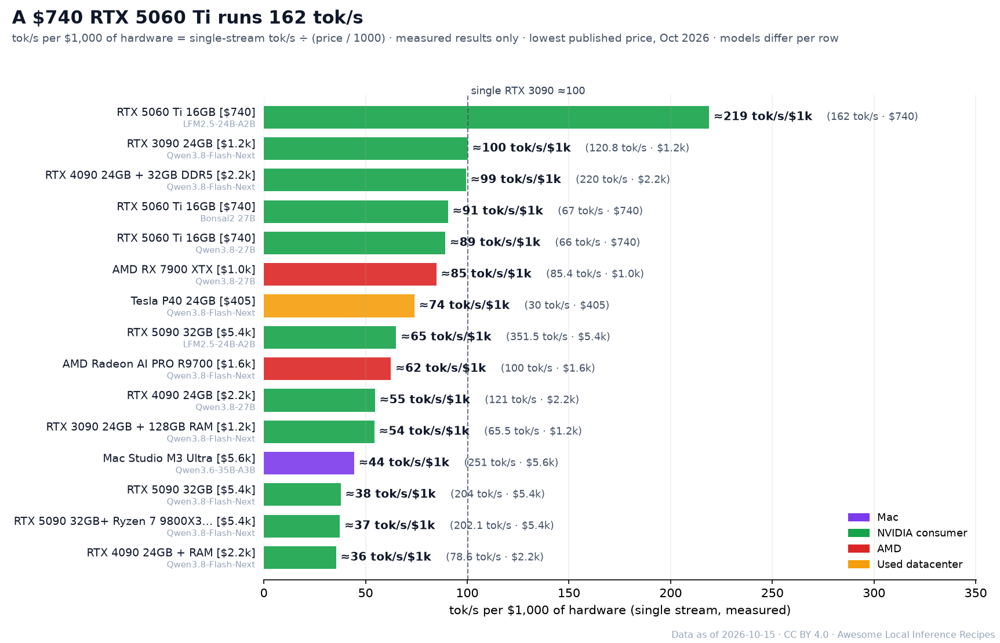
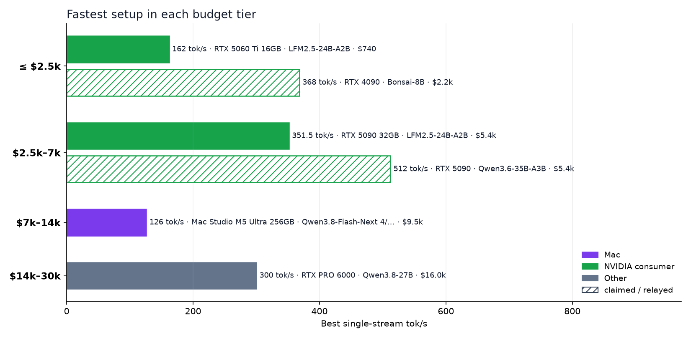

<h1 align="center">Awesome Local Inference Recipes </h1>

What speed will <b>your</b> hardware actually get? 328 source-backed local AI recipes, from a $405 GPU to a $30k rig.

<b>English</b> · <a href="README.zh-CN.md">简体中文</a> · <a href="README.ja.md">日本語</a>

      

<a href="https://raytone-lab.github.io/Awesome-local-inference-recipe/explore.html"><b>Explore live</b></a> · <a href="recipes/README.md"><b>Recipe guides</b></a> · <a href="docs/getting-started.md"><b>Getting started</b></a> · <a href="https://raytone-lab.github.io/Awesome-local-inference-recipe/submit.html"><b>Submit a recipe</b></a>

### How fast is X tok/s?

Same answer, real Qwen3 tokens, streamed at 10 / 20 / 50 / 100 / 200 / 500 tok/s (log-spaced) vs. silent reading (≈5 tok/s, Brysbaert 2019), with cloud-API medians from Artificial Analysis for comparison. <a href="https://raytone-lab.github.io/Awesome-local-inference-recipe/speed.html"><b>Try it interactively →</b></a>

**328 recipes** (287 text · 16 image · 25 video & audio) · **6 hardware families** · **38 engines** · **12 model families** · every number linked to its source · budget up to **$30k**

### Headline numbers

| Record                   | Model · engine               | Hardware                                                                           | Result           | Source                                                                    |
| ------------------------ | ---------------------------- | ---------------------------------------------------------------------------------- | ---------------- | ------------------------------------------------------------------------- |
| Fastest on a Mac         | Qwen3.6-35B-A3B · DFlash     | Mac Studio M3 Ultra · ≈ $5,649 (base config price; test machine memory not stated) | **251 tok/s** ✅  | [source](https://x.com/tinybluedev/status/2089910202606764530)            |
| Fastest on one RTX 5090  | Qwen3.8-Flash-Next · Strata  | RTX 5090 + 256GB RAM · ≈ $5,400 (card only, excl. 256GB RAM)                       | **176 tok/s** ✅  | [@TechPractice1](https://x.com/TechPractice1/status/2105087037363884483)  |
| Fastest on AMD           | Qwen3.8-Flash-Next · Strata  | AMD Radeon AI PRO R9700 · ≈ $1,600                                                 | **100 tok/s** ✅  | [@TechPractice1](https://x.com/TechPractice1/status/2105338176055509376)  |
| Used datacenter GPUs     | Qwen3.8-Flash-Next · Strata  | 2× Tesla V100 32GB PCIe                                                            | **120 tok/s** ✅  | [@rewin123](https://x.com/rewin123/status/2108669905616736529)            |
| Fastest on one DGX Spark | Qwen3.8-Flash-Next · ExLlama | 1× DGX Spark · ≈ $6,950                                                            | **71.7 tok/s** ✅ | [source](https://x.com/yume_arasaki/status/2101741448811229219)           |
| Cheapest rig in the list | Qwen3.8-Flash-Next · Strata  | Tesla P40 24GB · ≈ $405                                                            | **30 tok/s** ✅   | [source](https://github.com/Niko1221/Strata/blob/main/docs/OLDER_GPUS.md) |

Single-stream generation speed, copied from each source; prices are the lowest published hardware price. ✅ = measured by the poster.

## Contents

- [Legend](#legend)
- [Hot This Month](#hot-this-month)
- [Browse by Model Family](#browse-by-model-family)
- [Browse by Engine](#browse-by-engine)
- [Tier 1 · up to $2.5k](#tier-1--up-to-25k)
- [Tier 2 · $2.5k–7k](#tier-2--25k7k)
- [Tier 3 · $7k–14k](#tier-3--7k14k)
- [Tier 4 · $14k–30k](#tier-4--14k30k)
- [Cost Not Published](#cost-not-published)
- [Engines & Tools](#engines--tools)
- [Related Lists & Benchmarks](#related-lists--benchmarks)
- [License](#license)

## Legend

| Source level     | Meaning                               | Format                                                                  |
| ---------------- | ------------------------------------- | ----------------------------------------------------------------------- |
| 🏛️ **Official** | vendor or project number              | **Model** · Engine `quant` — Hardware → **key number** level \[source\] |
| ✅ **Measured**   | author ran it, with log or screenshot | **tok/s** = single-stream generation (not prefill, not aggregate)       |
| 🔁 **Relayed**   | second-hand, verify upstream          | Tiers use the lowest published hardware price (USD)                     |
| 📣 **Claimed**   | projection, no reproduction           | Unknown values are never estimated                                      |

## Hot This Month

Most-engaged recipe posts on X, 2026-09-15 → 10-15 (likes + 3×reposts).

- **DeepSeek-V4.1-Flash** — 2× DGX Spark → **29 tok/s** ✅ [@0xSero](https://x.com/0xSero/status/2106373861818224907) ♥2470
- **Qwen3.8-Flash-Next** · vLLM — 1× DGX Spark → **48.7 tok/s** ✅ [@MiaAI_lab](https://x.com/MiaAI_lab/status/2101339268203380857) ♥800
- **GLM-5.3-Flash EXL3 4-bit** · TensorFold — 2× DGX Spark → **60.4 tok/s** ✅ [@MiaAI_lab](https://x.com/MiaAI_lab/status/2105598458547646875) ♥683
- **Qwen3.8-Flash-Next** — RTX 3090 24GB + 64GB DDR4/5 + 100GB NVMe → **64 tok/s** 📣 [@0xSero](https://x.com/0xSero/status/2104865431659892934) ♥686
- **Qwen3.8-Flash-Next** · Strata — RTX 5090 32GB → **204 tok/s** ✅ [@niklaslenz_ai](https://x.com/niklaslenz_ai/status/2110132306061013386) ♥469
- **Qwen3.8-Flash-Next** · TensorFold — 1× DGX Spark → **64.4 tok/s** ✅ [@MiaAI_lab](https://x.com/MiaAI_lab/status/2108203605685596490) ♥386
- **DeepSeek-V4-Flash (0731 GA)** — 2× DGX Spark → **82 tok/s** ✅ [@MiaAI_lab](https://x.com/MiaAI_lab/status/2083326111144906836) ♥368
- **Qwen3.8-27B** · vLLM — RTX 5090 32GB → **147 tok/s** ✅ [@MiaAI_lab](https://x.com/MiaAI_lab/status/2088734058842878037) ♥381

## Browse by Model Family

Click a family to open the explorer pre-filtered. Tags: [`long-context`](https://raytone-lab.github.io/Awesome-local-inference-recipe/explore.html?tag=long-context) 107, [`dense`](https://raytone-lab.github.io/Awesome-local-inference-recipe/explore.html?tag=dense) 107, [`speculative`](https://raytone-lab.github.io/Awesome-local-inference-recipe/explore.html?tag=speculative) 100, [`4bit`](https://raytone-lab.github.io/Awesome-local-inference-recipe/explore.html?tag=4bit) 91, [`MTP`](https://raytone-lab.github.io/Awesome-local-inference-recipe/explore.html?tag=MTP) 63, [`MoE`](https://raytone-lab.github.io/Awesome-local-inference-recipe/explore.html?tag=MoE) 50, [`multi-GPU`](https://raytone-lab.github.io/Awesome-local-inference-recipe/explore.html?tag=multi-GPU) 49, [`3bit`](https://raytone-lab.github.io/Awesome-local-inference-recipe/explore.html?tag=3bit) 36, [`8bit`](https://raytone-lab.github.io/Awesome-local-inference-recipe/explore.html?tag=8bit) 29, [`2bit`](https://raytone-lab.github.io/Awesome-local-inference-recipe/explore.html?tag=2bit) 28, [`offload`](https://raytone-lab.github.io/Awesome-local-inference-recipe/explore.html?tag=offload) 28, [`ternary`](https://raytone-lab.github.io/Awesome-local-inference-recipe/explore.html?tag=ternary) 23, [`1bit`](https://raytone-lab.github.io/Awesome-local-inference-recipe/explore.html?tag=1bit) 12, [`few-step`](https://raytone-lab.github.io/Awesome-local-inference-recipe/explore.html?tag=few-step) 12, [`bf16`](https://raytone-lab.github.io/Awesome-local-inference-recipe/explore.html?tag=bf16) 6, [`6bit`](https://raytone-lab.github.io/Awesome-local-inference-recipe/explore.html?tag=6bit) 6, [`abliterated`](https://raytone-lab.github.io/Awesome-local-inference-recipe/explore.html?tag=abliterated) 4, [`5bit`](https://raytone-lab.github.io/Awesome-local-inference-recipe/explore.html?tag=5bit) 1.

| Family                                                                                                      | Recipes | Text | Image | Video & Audio |
| ----------------------------------------------------------------------------------------------------------- | ------- | ---- | ----- | ------------- |
| [Qwen](https://raytone-lab.github.io/Awesome-local-inference-recipe/explore.html?family=Qwen)               | 183     | 183  |       |               |
| [Bonsai](https://raytone-lab.github.io/Awesome-local-inference-recipe/explore.html?family=Bonsai)           | 30      | 30   |       |               |
| [DeepSeek](https://raytone-lab.github.io/Awesome-local-inference-recipe/explore.html?family=DeepSeek)       | 27      | 27   |       |               |
| [GLM](https://raytone-lab.github.io/Awesome-local-inference-recipe/explore.html?family=GLM)                 | 25      | 25   |       |               |
| [MiniMax H3](https://raytone-lab.github.io/Awesome-local-inference-recipe/explore.html?family=MiniMax%20H3) | 17      |      |       | 17            |
| [Qwen-Image](https://raytone-lab.github.io/Awesome-local-inference-recipe/explore.html?family=Qwen-Image)   | 13      |      | 13    |               |
| [LTX](https://raytone-lab.github.io/Awesome-local-inference-recipe/explore.html?family=LTX)                 | 4       |      |       | 4             |
| [Z-Image](https://raytone-lab.github.io/Awesome-local-inference-recipe/explore.html?family=Z-Image)         | 3       |      | 3     |               |
| [ACE-Step](https://raytone-lab.github.io/Awesome-local-inference-recipe/explore.html?family=ACE-Step)       | 2       |      |       | 2             |
| [Edge0](https://raytone-lab.github.io/Awesome-local-inference-recipe/explore.html?family=Edge0)             | 2       | 2    |       |               |
| [Gemma](https://raytone-lab.github.io/Awesome-local-inference-recipe/explore.html?family=Gemma)             | 2       | 2    |       |               |
| [Wan](https://raytone-lab.github.io/Awesome-local-inference-recipe/explore.html?family=Wan)                 | 2       |      |       | 2             |
| [Other](https://raytone-lab.github.io/Awesome-local-inference-recipe/explore.html?family=Other)             | 18      | 18   |       |               |

## Browse by Engine

Engine names are normalized (`scripts/normalize_engines.py`); original strings are kept in `engine_note`.

| Engine                                                                                                                                              | Recipes |
| --------------------------------------------------------------------------------------------------------------------------------------------------- | ------- |
| [llama.cpp](https://raytone-lab.github.io/Awesome-local-inference-recipe/explore.html?engine=llama.cpp)                                             | 37      |
| [Strata](https://raytone-lab.github.io/Awesome-local-inference-recipe/explore.html?engine=Strata)                                                   | 34      |
| [oMLX](https://raytone-lab.github.io/Awesome-local-inference-recipe/explore.html?engine=oMLX)                                                       | 30      |
| [TensorFold](https://raytone-lab.github.io/Awesome-local-inference-recipe/explore.html?engine=TensorFold)                                           | 22      |
| [MLX](https://raytone-lab.github.io/Awesome-local-inference-recipe/explore.html?engine=MLX)                                                         | 17      |
| [vLLM](https://raytone-lab.github.io/Awesome-local-inference-recipe/explore.html?engine=vLLM)                                                       | 16      |
| [llama.cpp (PrismML fork)](https://raytone-lab.github.io/Awesome-local-inference-recipe/explore.html?engine=llama.cpp%20%28PrismML%20fork%29)       | 14      |
| [ComfyUI](https://raytone-lab.github.io/Awesome-local-inference-recipe/explore.html?engine=ComfyUI)                                                 | 12      |
| [MTPLX](https://raytone-lab.github.io/Awesome-local-inference-recipe/explore.html?engine=MTPLX)                                                     | 11      |
| [SGLang](https://raytone-lab.github.io/Awesome-local-inference-recipe/explore.html?engine=SGLang)                                                   | 10      |
| [DFlash](https://raytone-lab.github.io/Awesome-local-inference-recipe/explore.html?engine=DFlash)                                                   | 7       |
| [mlx-serve](https://raytone-lab.github.io/Awesome-local-inference-recipe/explore.html?engine=mlx-serve)                                             | 7       |
| [Splash](https://raytone-lab.github.io/Awesome-local-inference-recipe/explore.html?engine=Splash)                                                   | 5       |
| [Project Maya](https://raytone-lab.github.io/Awesome-local-inference-recipe/explore.html?engine=Project%20Maya)                                     | 4       |
| [mirai-s-ada](https://raytone-lab.github.io/Awesome-local-inference-recipe/explore.html?engine=mirai-s-ada)                                         | 4       |
| [ExLlama](https://raytone-lab.github.io/Awesome-local-inference-recipe/explore.html?engine=ExLlama)                                                 | 3       |
| [Ollama](https://raytone-lab.github.io/Awesome-local-inference-recipe/explore.html?engine=Ollama)                                                   | 3       |
| [ds4 (DwarfStar)](https://raytone-lab.github.io/Awesome-local-inference-recipe/explore.html?engine=ds4%20%28DwarfStar%29)                           | 3       |
| [llama.cpp (agentionai fork)](https://raytone-lab.github.io/Awesome-local-inference-recipe/explore.html?engine=llama.cpp%20%28agentionai%20fork%29) | 3       |
| [Halogen](https://raytone-lab.github.io/Awesome-local-inference-recipe/explore.html?engine=Halogen)                                                 | 2       |
| [MLX Swift](https://raytone-lab.github.io/Awesome-local-inference-recipe/explore.html?engine=MLX%20Swift)                                           | 2       |
| [Radiance (fork)](https://raytone-lab.github.io/Awesome-local-inference-recipe/explore.html?engine=Radiance%20%28fork%29)                           | 2       |
| [TabbyAPI](https://raytone-lab.github.io/Awesome-local-inference-recipe/explore.html?engine=TabbyAPI)                                               | 2       |
| [edge0](https://raytone-lab.github.io/Awesome-local-inference-recipe/explore.html?engine=edge0)                                                     | 2       |
| [llama.cpp (OpenBMB fork)](https://raytone-lab.github.io/Awesome-local-inference-recipe/explore.html?engine=llama.cpp%20%28OpenBMB%20fork%29)       | 2       |
| [DS41RT](https://raytone-lab.github.io/Awesome-local-inference-recipe/explore.html?engine=DS41RT)                                                   | 1       |
| [FreeToken](https://raytone-lab.github.io/Awesome-local-inference-recipe/explore.html?engine=FreeToken)                                             | 1       |
| [Infernix](https://raytone-lab.github.io/Awesome-local-inference-recipe/explore.html?engine=Infernix)                                               | 1       |
| [LightX2V](https://raytone-lab.github.io/Awesome-local-inference-recipe/explore.html?engine=LightX2V)                                               | 1       |
| [MLX Swift (PrismML fork)](https://raytone-lab.github.io/Awesome-local-inference-recipe/explore.html?engine=MLX%20Swift%20%28PrismML%20fork%29)     | 1       |
| [NVIDIA Sol](https://raytone-lab.github.io/Awesome-local-inference-recipe/explore.html?engine=NVIDIA%20Sol)                                         | 1       |
| [Osaurus](https://raytone-lab.github.io/Awesome-local-inference-recipe/explore.html?engine=Osaurus)                                                 | 1       |
| [TandemLLM](https://raytone-lab.github.io/Awesome-local-inference-recipe/explore.html?engine=TandemLLM)                                             | 1       |
| [llama.cpp (mirai-s fork)](https://raytone-lab.github.io/Awesome-local-inference-recipe/explore.html?engine=llama.cpp%20%28mirai-s%20fork%29)       | 1       |
| [llama.cpp (vahpetr fork)](https://raytone-lab.github.io/Awesome-local-inference-recipe/explore.html?engine=llama.cpp%20%28vahpetr%20fork%29)       | 1       |
| [mflux](https://raytone-lab.github.io/Awesome-local-inference-recipe/explore.html?engine=mflux)                                                     | 1       |
| [sparkinfer](https://raytone-lab.github.io/Awesome-local-inference-recipe/explore.html?engine=sparkinfer)                                           | 1       |
| [sushi](https://raytone-lab.github.io/Awesome-local-inference-recipe/explore.html?engine=sushi)                                                     | 1       |
| [Unspecified](https://raytone-lab.github.io/Awesome-local-inference-recipe/explore.html?engine=Unspecified)                                         | 61      |

## Tier 1 · up to $2.5k

*Used 3090/4090, MI50/V100 cards, Strix Halo, R9700* · 49 recipes

**📝 Text**

- **Bonsai-8B** · llama.cpp (PrismML fork) `1-bit Q1_0` — RTX 4090 → **368 tok/s** 📣 [source](https://huggingface.co/prism-ml/Bonsai-8B-gguf)
- **Qwen3.6-35B-A3B-Escha-W2** · SGLang `Escha W2` — RTX 4090 24GB → **225 tok/s** 📣 [source](https://huggingface.co/EschaLabs/Qwen3.6-35B-A3B-Escha-W2)
- **Qwen3.8-Flash-Next** · Strata `Strata· Swift 1.5 IQ2_XS` — RTX 4090 24GB + 32GB DDR5 → **220 tok/s** ✅ [source](https://x.com/Knuckles_XBT/status/2105245662657011841)
- **Qwen3.6-35B-A3B** · FreeToken `FreeToken · NVFP4` — RTX 4090 → **167 tok/s** 🔁 [source](https://x.com/shipfrontierai/status/2092602493213577481)
- **LFM2.5-24B-A2B** · llama.cpp `Q4` — RTX 5060 Ti 16GB → **162 tok/s** ✅ [source](https://x.com/niklaslenz_ai/status/2110469931011612895)
- **Qwen3.6-35B-A3B-Escha-W2** · SGLang `Escha W2` — RTX 3090 24GB → **154 tok/s** 📣 [source](https://huggingface.co/EschaLabs/Qwen3.6-35B-A3B-Escha-W2)
- **Qwen3.8-27B** · DFlash `DFlash2` — RTX 3090 24GB → **138 tok/s** 🔁 [source](https://x.com/yume_arasaki/status/2090971775714939097)
- **Bonsai-8B** · MLX `1-bit g128` — MacBook M4 Pro 48GB → **131 tok/s** 📣 [source](https://huggingface.co/prism-ml/Bonsai-8B-mlx-1bit)
- **Qwen3.8-27B** · DFlash `EXL3 4.0bpw + DFlash2 3-bit…` — RTX 4090 24GB → **121 tok/s** ✅ [source](https://x.com/yume_arasaki/status/2100595901006008791)
- **Qwen3.8-Flash-Next** · Strata `Strata · IQ3_S` — RTX 3090 24GB → **120.8 tok/s** ✅ [source](https://x.com/needmorevram/status/2105050786938118599)
- *…and 31 more in the [explorer](https://raytone-lab.github.io/Awesome-local-inference-recipe/explore.html).*

**🖼️ Image**

- **Qwen-Image 2.1** · ComfyUI `Comfy-Org INT8 · ComfyUI` — RTX 4090 24GB → see source ✅ [source](https://x.com/yume_arasaki/status/2102176739359404499) · [guide](recipes/image-001.md)
- **Qwen-Image 2.1** `INT8` — RTX 3090 → see source 🔁 [source](https://x.com/yume_arasaki/status/2102176739359404499)
- **Qwen-Image 2.1** · ComfyUI `ComfyUI` — Mac M4 Pro → see source ✅ [source](https://x.com/gabeciii/status/2104920039077884324)
- **Z-Image Turbo** · ComfyUI `ComfyUI` — RTX 3090 24GB → see source ✅ [source](https://x.com/michaelricks/status/2104959036353356058)

**🎬 Video & Audio**

- **FastH3 V2 / Trim** `FP8` — RTX 4090 24GB → see source 🏛️ [source](https://haoailab.com/blogs/fasth3-rtx/)
- **MiniMax H3** · ComfyUI `ComfyUI` — RTX 4090 → see source ✅ [source](https://x.com/yume_arasaki/status/2097790831323427046)
- **MiniMax H3** · ComfyUI `ComfyUI` — RTX 3090 → see source ✅ [source](https://x.com/natehalko/status/2103538997146611890)
- **ACE-Step 1.5** — RTX 3090 → see source 🔁 [source](https://x.com/simplifyinAI/status/2091935190335754493)

## Tier 2 · $2.5k–7k

*One RTX 5090, one DGX Spark, Mac Studio Max* · 115 recipes

**📝 Text**

- **Qwen3.6-35B-A3B** · sparkinfer `sparkinfer v0.4.4` — RTX 5090 → **512 tok/s** 📣 [source](https://x.com/kysstalol/status/2105042922643321008)
- **LFM2.5-24B-A2B** · llama.cpp `Q4` — RTX 5090 32GB → **351.5 tok/s** ✅ [source](https://x.com/niklaslenz_ai/status/2110469931011612895)
- **Qwen3.6-35B-A3B-Escha-W2** · SGLang `Escha W2` — RTX 5090 32GB → **283 tok/s** 📣 [source](https://huggingface.co/EschaLabs/Qwen3.6-35B-A3B-Escha-W2) · [guide](recipes/hf-eschalabs-qwen3-6-35b-a3b-escha-w2-1.md)
- **Qwen3.6-35B-A3B** · DFlash `DFlash 2` — Mac Studio M3 Ultra → **251 tok/s** ✅ [source](https://x.com/tinybluedev/status/2089910202606764530)
- **Qwen3.8-Flash-Next** · Strata `ISTA-DASLab GSQ-RCO GGUF IQ…` — RTX 5090 32GB → **204 tok/s** ✅ [source](https://x.com/niklaslenz_ai/status/2110132306061013386)
- **Qwen3.8-Flash-Next** · Strata `GSQ RCO IQ3_XXS` — RTX 5090 32GB+ Ryzen 7 9800X3D + 60.5GB DDR5 → **202.1 tok/s** ✅ [source](https://github.com/Niko1221/Strata/pull/2165)
- **Qwen3.8-Flash-Next** · Strata `IQ2_XS` — RTX 5090 + 256GB RAM → **176 tok/s** ✅ [source](https://x.com/TechPractice1/status/2105087037363884483)
- **Qwen3.8-27B** · llama.cpp `GPU-1+ DFlash2` — RTX 5090 32GB → **176 tok/s** 📣 [source](https://huggingface.co/byteshape/Qwen3.8-27B-GGUF)
- **Qwen3.8-27B** · TensorFold `MLX 4-bit` — RTX 5090 32GB → **174 tok/s** ✅ [source](https://x.com/niklaslenz_ai/status/2109985001572069380)
- **Qwen3.8-27B** · llama.cpp `GPU-5+ DFlash2` — RTX 5090 32GB → **167 tok/s** 📣 [source](https://huggingface.co/byteshape/Qwen3.8-27B-GGUF)
- *…and 87 more in the [explorer](https://raytone-lab.github.io/Awesome-local-inference-recipe/explore.html).*

**🖼️ Image**

- **Qwen-Image 2.1** `LightX2V / BennyDaBall NVFP…` — RTX 5090 32GB → see source 🔁 [source](https://x.com/yume_arasaki/status/2103277400234860878)
- **Qwen-Image 2.1** · TensorFold `TensorFold NVFP4 / FP8 / GG…` — RTX 5090 @450W → see source ✅ [source](https://x.com/niklaslenz_ai/status/2106465941177487871)
- **Qwen-Image 2.1** — RTX 5090 → see source 📣 [source](https://x.com/fractalyze_io/status/2105207217452695841)
- **Qwen-Image 2.1** · SGLang `spark-image-lab BF16 / SGLa…` — 1× DGX Spark → see source 🔁 [source](https://x.com/yume_arasaki/status/2103277400234860878)
- **Qwen-Image-2.1-Turbo** `Turbo 8 vs Base 40` — RTX 5090 → see source ✅ [source](https://x.com/niklaslenz_ai/status/2108609693941920176)
- **Z-Image Turbo vs Qwen-Image 2.1** `prompt seed 20` — RTX 5090 → see source ✅ [source](https://x.com/princedoesai/status/2109376490009743713)

**🎬 Video & Audio**

- **FastH3 V2** `NVFP4` — RTX 5090 32GB → see source 🏛️ [source](https://haoailab.com/blogs/fasth3-rtx/) · [guide](recipes/video-audio-001.md)
- **FastH3 Trim** `NVFP4` — RTX 5090 → see source 🏛️ [source](https://haoailab.com/blogs/fasth3-rtx/)
- **FastH3 V2 / Trim** `NVFP4` — 1× / 2× DGX Spark → see source 🏛️ [source](https://haoailab.com/blogs/fasth3-rtx/)
- **MiniMax H3** · ComfyUI `ComfyUI + SageAttention` — RTX 5090 → see source ✅ [source](https://x.com/RKAScope/status/2084359480926503182)
- **MiniMax H3 vs FastH3 Turbo** `seed` — RTX 5090 → see source ✅ [source](https://x.com/Sogni_Protocol/status/2097254959729246550)
- **MiniMax H3** · NVIDIA Sol `NVIDIA Sol` — 1× DGX Spark → see source ✅ [source](https://x.com/yume_arasaki/status/2100734364908986511)
- **MiniMax H3 vs LTX-2.3 Eros** `3 prompt` — 1× DGX Spark → see source ✅ [source](https://x.com/YRSM_Simon/status/2084222856972456336)
- **LTX-2.3** · ComfyUI `ComfyUI` — RTX 5090 → see source ✅ [source](https://x.com/freshstartsnow/status/2092263835591655773)
- **LTX-2.5** `LoRA` — RTX 5090 → see source ✅ [source](https://x.com/PhotogenicWeekE/status/2087298681137701274)
- **ACE-Step 1.5 + LTX-2.3** · ComfyUI `ComfyUI` — 1× DGX Spark → see source 🔁 [source](https://x.com/yume_arasaki/status/2100734364908986511)
- **Wan2.1 14B** `97% + 3 + FP8` — RTX 5090 → see source 📣 [source](https://x.com/thePandaily/status/2105209996648567243)
- **MiniMax H3** · LightX2V — RTX 5090 → 768×1344 15s video + audio ≈72 s (steady state, excl. MP4 export; bas… 🏛️ [source](https://x.com/LightX2V/status/2108769912009424976)

## Tier 3 · $7k–14k

*Two Sparks, Mac Studio Ultra* · 29 recipes

**📝 Text**

- **Qwen3.8-Flash-Next 4/8-bit** · mlx-serve `4/8-bit mixed` — Mac Studio M5 Ultra 256GB → **126 tok/s** ✅ [source](https://x.com/LocalSilicon/status/2106175358160793817)
- **DeepSeek-V4.1-Flash** · TensorFold — 2× DGX Spark → **95 tok/s** ✅ [source](https://x.com/Urthoo/status/2106426248759005362)
- **DeepSeek-V4-Flash (0731 GA)** `FP8` — 2× DGX Spark → **82 tok/s** ✅ [source](https://x.com/MiaAI_lab/status/2083326111144906836)
- **Qwen3.8-Flash-Next** · TensorFold `TensorFold · NVFP4 / INT4-A…` — 2× DGX Spark → **67.4 tok/s** 🔁 [source](https://x.com/llm_frontier_jp/status/2108884169069916440)
- **DeepSeek-V4-Flash** · vLLM — 2× DGX Spark → **63.7 tok/s** ✅ [source](https://senn-tech.com/en/blog/dgx-spark-verbund-deepseek-v41-flash)
- **GLM-5.3-Flash EXL3** `EXL3` — 2× DGX Spark (GB10) → **61.43 tok/s** ✅ [source](https://x.com/JASONMCNAB/status/2106367944963842279)
- **GLM-5.3-Flash EXL3 4-bit** · TensorFold `EXL3 4-bit` — 2× DGX Spark → **60.4 tok/s** ✅ [source](https://x.com/MiaAI_lab/status/2105598458547646875)
- **DeepSeek-V4.1-Flash** · vLLM `EXL3 2–5 bit` — 2× DGX Spark → **57.9 tok/s** ✅ [source](https://x.com/sudoingX/status/2109957456709472609)
- **Qwen3.8-Flash-Next** · vLLM `GPTQ-INT4 · int8 KV` — 6× RTX 3090 + 7950X + 187GB RAM → **57.6 tok/s** ✅ [source](https://www.reddit.com/r/LocalLLaMA/comments/1x3wjzf/qwen38flashnext_on_six_3090s_with_vllm_7_users_at/)
- **DeepSeek-V4.1-Flash** · vLLM `EXL3 2–5 bit` — 2× DGX Spark → **57.2 tok/s** ✅ [source](https://x.com/yume_arasaki/status/2110460251820732478)
- *…and 19 more in the [explorer](https://raytone-lab.github.io/Awesome-local-inference-recipe/explore.html).*

## Tier 4 · $14k–30k

*3–4 Spark clusters, multi-GPU workstations* · 11 recipes

**📝 Text**

- **Qwen3.8-27B** · SGLang `NVFP4` — RTX PRO 6000 → **300 tok/s** ✅ [source](https://x.com/MiaAI_lab/status/2090327658508763516)
- **GLM-5.3-Flash EXL3** · TensorFold `EXL3` — 4× DGX Spark → **95 tok/s** ✅ [source](https://x.com/MiaAI_lab/status/2108939694918488183)
- **Qwen3.8-Flash-Next** · Radiance (fork) `Radiance fork · int4fp8 · B…` — 4× AMD R9700 32GB + TR 9970X + 128GB → see source 🔁 [source](https://x.com/richgel999/status/2109515169638326738)
- **Qwen3.8-27B** · Radiance (fork) `MXFP4 · Radiance fork` — 4× R9700 → see source 🔁 [source](https://x.com/richgel999/status/2109515169638326738)
- **GLM-5.3-Flash** `Mia EXL3` — 3× DGX Spark → see source 🔁 [source](https://x.com/yume_arasaki/status/2106837882870886438)
- **GLM-5.3-Flash** · TensorFold `TensorFold · Thunderbolt 5×…` — 2× Mac Studio M5 Ultra → see source 🔁 [source](https://x.com/yume_arasaki/status/2108359576966094952)
- **DeepSeek-V4.1-Flash** `Mia MXFP4/FP8 · Engram NVMe` — 3× DGX Spark → see source 🔁 [source](https://x.com/yume_arasaki/status/2099966865326170554)
- **DeepSeek-V4.1-Flash** · TensorFold `tonyd615 MXFP4 / Mia Tensor…` — 4× DGX Spark → see source 🔁 [source](https://x.com/yume_arasaki/status/2106837882870886438)
- **DeepSeek-V4.1-Flash** — 4× DGX Spark → see source 🔁 [source](https://x.com/hardfanaticos/status/2107225102475813374)
- **DeepSeek-V4.1-Flash** · MLX `MLX Q4i / DwarfStar` — M3 Ultra 512GB / M5 Max 128GB → see source 🔁 [source](https://x.com/yume_arasaki/status/2099966865326170554)
- *…and 1 more in the [explorer](https://raytone-lab.github.io/Awesome-local-inference-recipe/explore.html).*

## Cost Not Published

Multi-card builds priced per card, Macs without a listed price, and other rows without a single published price · 124 recipes. Top text recipes by tok/s:

- **Qwen3.6-35B-A3B-Escha-W2** · SGLang `Escha W2` — RTX 5080 16GB → **212 tok/s** 📣 [source](https://huggingface.co/EschaLabs/Qwen3.6-35B-A3B-Escha-W2)
- **Qwen3.6-35B-A3B** · Splash `Splash` — Mac M5 Pro 48GB → **210 tok/s** 🔁 [source](https://x.com/TeksEdge/status/2101735798567764421)
- **Qwen3.6-35B-A3B** · oMLX `oMLX 0.7.1.dev1` — Mac M5 Max → **205 tok/s** 🏛️ [source](https://x.com/jundotkim/status/2108584837590495246)
- **LFM2.5-24B-A2B** `Q4_K_M` — Apple M5 Max → **184 tok/s** 📣 [source](https://x.com/TeksEdge/status/2110061971064438960)
- **MiniCPM-V 4.7 35B-A3B** · llama.cpp `Q4_K_M` — RTX 5090 → **176 tok/s** ✅ [source](https://x.com/sudoingX/status/2110400760601317696)
- **Qwen3.8-Flash-Next-MLX-Serve-iQ-MLX-4.7bpw** · mlx-serve `iQ-MLX 4.7 bpw` — Mac Studio M5 Ultra → **157 tok/s** 📣 [source](https://huggingface.co/ddalcu/Qwen3.8-Flash-Next-MLX-Serve-iQ-MLX-4.7bpw)
- **Qwen3.6-35B-A3B** · llama.cpp `Q4` — RTX 5090 → **157 tok/s** ✅ [source](https://x.com/sudoingX/status/2110400760601317696)
- **Qwen3.8-27B** · vLLM `vLLM` — CMP 170HX → **147 tok/s** 🔁 [source](https://x.com/LFrefman/status/2101572845017178243)
- **Qwen3.8-27B** · Splash `Splash` — Mac M5 Max → **144 tok/s** 🏛️ [source](https://x.com/zhijianliu/status/2101102949158302001)
- **Qwen3.6-35B-A3B-Escha-W2** · SGLang `Escha W2` — RTX 5060 Ti 16GB → **128 tok/s** 📣 [source](https://huggingface.co/EschaLabs/Qwen3.6-35B-A3B-Escha-W2)
- **GLM-5.3-Flash** `EXL3+ DS coordinator` — 4× DGX Spark + RTX 5090 → **124 tok/s** ✅ [source](https://x.com/dangerm00se/status/2104876537367728325)
- **Qwen3.8-Flash-Next** · Strata `IQ3_S` — 2× RTX 3090 (48GB) + 64GB DDR5-6000 → **120 tok/s** ✅ [source](https://x.com/geldeki/status/2109208295957201171) · [guide](recipes/x-004.md)
- *…browse all 124 in the [explorer](https://raytone-lab.github.io/Awesome-local-inference-recipe/explore.html).*

## Engines & Tools

| Project                                                       | ⭐ Stars | Live                                                                                            | Last push  | What                                                                                                    |
| ------------------------------------------------------------- | ------- | ----------------------------------------------------------------------------------------------- | ---------- | ------------------------------------------------------------------------------------------------------- |
| [llama.cpp](https://github.com/ggml-org/llama.cpp)            | 131.0k  |               | 2026-10-13 | The baseline GGUF engine (CPU/CUDA/ROCm/Vulkan/Metal).                                                  |
| [vLLM](https://github.com/vllm-project/vllm)                  | 93.7k   |                | 2026-10-13 | High-throughput server; MTP and multi-stream recipes on Spark.                                          |
| [SGLang](https://github.com/sgl-project/sglang)               | 37.1k   |               | 2026-10-13 | Serving framework; paired with DFlash2 on DGX Spark.                                                    |
| [MLX](https://github.com/ml-explore/mlx)                      | 28.8k   |                   | 2026-10-13 | Apple's array framework behind most Mac recipes.                                                        |
| [Strata](https://github.com/Niko1221/Strata)                  | 23.5k   |                  | 2026-10-12 | MoE engine that splits experts across GPU, RAM and SSD for 12–24GB cards; most Flash-Next recipes here. |
| [oMLX](https://github.com/jundot/omlx)                        | 22.8k   |                      | 2026-10-13 | Apple Silicon MLX server with continuous batching and tiered KV/SSD cache.                              |
| [DFlash / DFlash 2](https://github.com/z-lab/dflash)          | 6.2k    |                     | 2026-08-18 | Block-diffusion speculative decoding; DFlash 2 drafts for Qwen3.8-27B.                                  |
| [LightX2V](https://github.com/ModelTC/LightX2V)               | 2.9k    |                 | 2026-10-13 | Video generation inference framework; MiniMax H3 results on a 5090.                                     |
| [TensorFold](https://github.com/ashhart/TensorFold)           | 1.3k    |               | 2026-10-12 | OpenAI-compatible MoE runtime with speculative decoding; also used for MiniMax H3 in ComfyUI.           |
| [halogen](https://github.com/peonist-ai/halogen-flash-server) | 954     |  | 2026-10-13 | Flash-Next server tuned for Strix Halo.                                                                 |
| [dflash-mlx](https://github.com/bstnxbt/dflash-mlx)           | 788     |               | 2026-08-20 | DFlash speculative decoding for MLX on Apple Silicon.                                                   |
| [FastH3](https://haoailab.com/blogs/fasth3-rtx/)              | —       | *(site/blog)*                                                                                   | —          | Hao AI Lab's 8-step distilled MiniMax H3 for RTX cards (blog).                                          |

⭐ Snapshot updated 2026-10-13T14:44Z (UTC) by `scripts/update_stars.py` · *Live* badges are rendered by shields.io at view time.

## Related Lists & Benchmarks

| Project                                                                     | ⭐ Stars | Live                                                                                            | Last push  | What                                                       |
| --------------------------------------------------------------------------- | ------- | ----------------------------------------------------------------------------------------------- | ---------- | ---------------------------------------------------------- |
| [Awesome-LLM-Inference](https://github.com/xlite-dev/Awesome-LLM-Inference) | 5.5k    |  | 2026-08-14 | Inference papers with code.                                |
| [awesome-local-llm](https://github.com/rafska/awesome-local-llm)            | 3.0k    |         | 2026-10-12 | Directory of local LLM platforms and tools.                |
| [LocalScore](https://github.com/cjpais/LocalScore)                          | 134     |                | 2026-10-09 | Standardized single-GPU benchmark CLI.                     |
| [llamabench.ai](https://llamabench.ai/)                                     | —       | *(site/blog)*                                                                                   | —          | llama.cpp results with full launch commands.               |
| [llamaperf](https://llamaperf.com/leaderboard)                              | —       | *(site/blog)*                                                                                   | —          | Community-reported leaderboard (medians).                  |
| [canirun.ai](https://canirun.ai/)                                           | —       | *(site/blog)*                                                                                   | —          | Estimates whether and how fast a model fits your hardware. |

⭐ Snapshot updated 2026-10-13T14:44Z (UTC) by `scripts/update_stars.py` · *Live* badges are rendered by shields.io at view time.

## Contributing

One recipe = one PR. Copy the YAML template from [submit.html](https://raytone-lab.github.io/Awesome-local-inference-recipe/submit.html), fill only what the source shows (`null` otherwise), run `node scripts/validate.mjs`, and link the post. Then run `python3 scripts/gen_readme.py` to regenerate all READMEs. See [CONTRIBUTING.md](CONTRIBUTING.md).

Dev: `python3 -m http.server 5190` → `index.html` (landing) · `explore.html` (filter/sort/scatter) · schema in [`schema/recipe.schema.json`](schema/recipe.schema.json).

Site preview

## License

- Code: [MIT](LICENSE)
- Data (`data/`): [CC BY 4.0](LICENSE-DATA). Reuse it freely with attribution to Awesome Local Inference Recipes and the original sources linked in each recipe.
