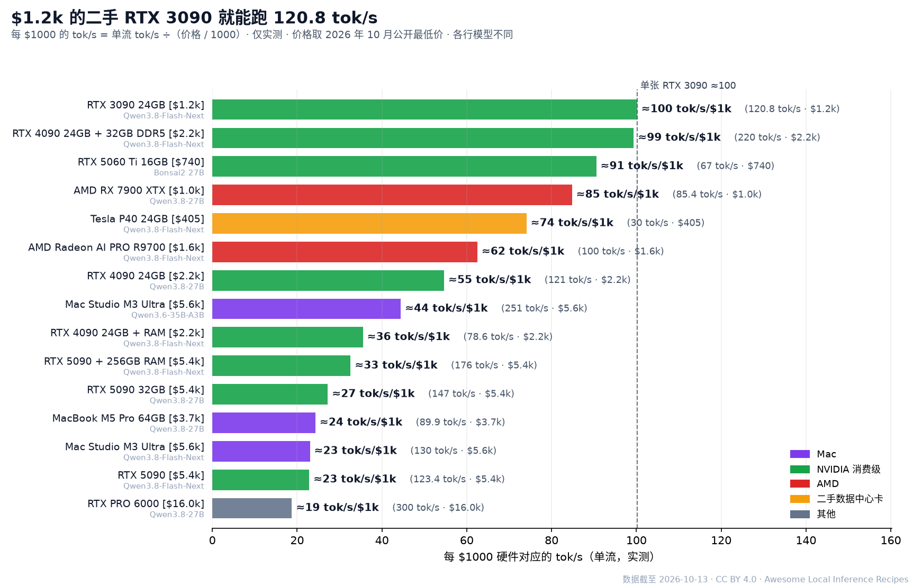
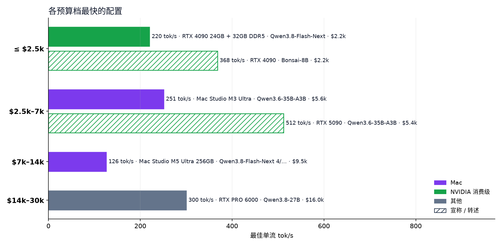

<h1 align="center">本地推理配方精选 </h1>

你的硬件到底能跑多快？337 条有出处的本地 AI 配方，从 405 美元的显卡到 3 万美元的整机。

<a href="README.md">English</a> · <b>简体中文</b> · <a href="README.ja.md">日本語</a>

      

<a href="https://raytone-lab.github.io/awesome-local-inference-recipes/explore.html"><b>在线配方库</b></a> · <a href="recipes/README.zh-CN.md"><b>配方指南</b></a> · <a href="docs/getting-started.zh-CN.md"><b>入门指南</b></a> · <a href="https://raytone-lab.github.io/awesome-local-inference-recipes/submit.html"><b>提交配方</b></a>

### X tok/s 到底有多快？

同一段回答、真实 Qwen3 token，以 10 / 20 / 50 / 100 / 200 / 500 tok/s（对数间隔）输出，对比默读速度（英文约 5 tok/s，Brysbaert 2019）和云端 API 中位速度（Artificial Analysis）。 <a href="https://raytone-lab.github.io/awesome-local-inference-recipes/speed.html"><b>在线互动体验 →</b></a>

**337 条配方**（文字 296 · 图像 16 · 影音 25）· **6 类硬件** · **40 种引擎** · **12 个模型系列** · 每个数字都有出处 · 预算 **3 万美元以内**

### 亮点数据

| 记录              | 模型 · 引擎                      | 硬件                                                | 结果               | 来源                                                                       |
| --------------- | ---------------------------- | ------------------------------------------------- | ---------------- | ------------------------------------------------------------------------ |
| Mac 最快          | Qwen3.6-35B-A3B · DFlash     | Mac Studio M3 Ultra · 约 $5,649（起步配置价格，原帖未注明测试机内存） | **251 tok/s** ✅  | [来源](https://x.com/tinybluedev/status/2089910202606764530)               |
| 单张 RTX 5090 最快  | Qwen3.8-Flash-Next · Strata  | RTX 5090 + 256GB RAM · 约 $5,400（仅显卡，不含 256GB 内存）  | **176 tok/s** ✅  | [@TechPractice1](https://x.com/TechPractice1/status/2105087037363884483) |
| AMD 最快          | Qwen3.8-Flash-Next · Strata  | AMD Radeon AI PRO R9700 · 约 $1,600                | **100 tok/s** ✅  | [@TechPractice1](https://x.com/TechPractice1/status/2105338176055509376) |
| 二手数据中心卡         | Qwen3.8-Flash-Next · Strata  | 2× Tesla V100 32GB PCIe（无 NVLink）                 | **120 tok/s** ✅  | [@rewin123](https://x.com/rewin123/status/2108669905616736529)           |
| 单台 DGX Spark 最快 | Qwen3.8-Flash-Next · ExLlama | 1× DGX Spark · 约 $6,950                           | **71.7 tok/s** ✅ | [来源](https://x.com/yume_arasaki/status/2101741448811229219)              |
| 最便宜的配置          | Qwen3.8-Flash-Next · Strata  | Tesla P40 24GB（二手） · 约 $405                       | **30 tok/s** ✅   | [来源](https://github.com/Niko1221/Strata/blob/main/docs/OLDER_GPUS.md)    |

单路生成速度，均摘自来源；价格为公开的最低硬件价格。✅ = 发帖人实测。

## 目录

- [图例](#图例)
- [快速问答](#快速问答)
- [本月热门](#本月热门)
- [按模型系列浏览](#按模型系列浏览)
- [按引擎浏览](#按引擎浏览)
- [第 1 档 · 2,500 美元以内](#第-1-档--2500-美元以内)
- [第 2 档 · 2,500–7,000 美元](#第-2-档--25007000-美元)
- [第 3 档 · 7,000–14,000 美元](#第-3-档--700014000-美元)
- [第 4 档 · 14,000–30,000 美元](#第-4-档--1400030000-美元)
- [价格未公开](#价格未公开)
- [引擎与工具](#引擎与工具)
- [相关榜单与清单](#相关榜单与清单)
- [许可证](#许可证)

## 图例

| 来源等级       | 含义            | 格式                                         |
| ---------- | ------------- | ------------------------------------------ |
| 🏛️ **官方** | 项目方或厂商发布的数字   | **模型** · 引擎 `量化` — 硬件 → **关键数字** 等级 \[来源\] |
| ✅ **实测**   | 作者本人跑出，附日志或截图 | **tok/s** 指单路生成速度（不含读入，不含多路合计）             |
| 🔁 **转述**  | 二手引用，请回原帖核对   | 预算档按公开的最低硬件价格（美元）划分                        |
| 📣 **宣称**  | 预测值，无复现条件     | 未知字段一律不估算，显示「未见公开数据」                       |

## 快速问答

数据截至 2026-10-15。每条回答取数据集中最快的单路文字生成结果，并标注来源等级；✅ = 发帖人实测。不同回答的模型不同。

**单张 RTX 5090 跑本地大模型有多快？**  
实测最快：**351.5 tok/s**，LFM2.5-24B-A2B · llama.cpp，硬件 RTX 5090 32GB（✅ 实测，2026-10-15，[来源](https://x.com/niklaslenz_ai/status/2110469931011612895)）。该硬件共 33 条配方，其中实测 14 条。

**单张 RTX 4090 跑本地大模型有多快？**  
实测最快：**121 tok/s**，Qwen3.8-27B · DFlash，硬件 RTX 4090 24GB（✅ 实测，日期未注明，[来源](https://x.com/yume_arasaki/status/2100595901006008791)）。该硬件共 9 条配方，其中实测 2 条。

**单张 RTX 3090 跑本地大模型有多快？**  
实测最快：**120.8 tok/s**，Qwen3.8-Flash-Next · Strata，硬件 单 RTX 3090 24GB + 64GB RAM（RAM 见同作者前帖）（✅ 实测，日期未注明，[来源](https://x.com/needmorevram/status/2105050786938118599)）。该硬件共 10 条配方，其中实测 3 条。

**Mac Studio M3 Ultra 跑本地大模型有多快？**  
实测最快：**251 tok/s**，Qwen3.6-35B-A3B · DFlash，硬件 Mac Studio M3 Ultra（✅ 实测，日期未注明，[来源](https://x.com/tinybluedev/status/2089910202606764530)）。该硬件共 16 条配方，其中实测 8 条。

**一台 NVIDIA DGX Spark 跑本地大模型有多快？**  
实测最快：**95 tok/s**，Qwen3.6-35B-A3B · vLLM，硬件 1× DGX Spark（✅ 实测，2026-07-29，[来源](https://x.com/MiaAI_lab/status/2082573590529204458)）。该硬件共 27 条配方，其中实测 15 条。

**AMD Strix Halo（Ryzen AI Max+ 395）跑本地大模型有多快？**  
实测最快：**61 tok/s**，Qwen3.8-Flash-Next · llama.cpp (vahpetr fork)，硬件 AMD Strix Halo 128GB（Ryzen AI Max+ 395，Vulkan）（✅ 实测，2026-10-10，[来源](https://github.com/ggml-org/llama.cpp/discussions/30282)）。该硬件共 13 条配方，其中实测 6 条。

**2500 美元以内实测最快的配置是什么？**  
实测最快：**162 tok/s**，LFM2.5-24B-A2B · llama.cpp，硬件 RTX 5060 Ti 16GB（✅ 实测，2026-10-15，[来源](https://x.com/niklaslenz_ai/status/2110469931011612895)）。该预算内共 44 条配方，其中实测 18 条。

## 本月热门

X 上互动最多的配方帖，2026-09-15 至 10-15（按 点赞 + 3×转发 排序）。

- **DeepSeek-V4.1-Flash** — 2× DGX Spark → **29 tok/s** ✅ [@0xSero](https://x.com/0xSero/status/2106373861818224907) ♥2470
- **Qwen3.8-Flash-Next** · vLLM — 1× DGX Spark → **48.7 tok/s** ✅ [@MiaAI_lab](https://x.com/MiaAI_lab/status/2101339268203380857) ♥800
- **GLM-5.3-Flash EXL3 4-bit** · TensorFold — 2× DGX Spark → **60.4 tok/s** ✅ [@MiaAI_lab](https://x.com/MiaAI_lab/status/2105598458547646875) ♥683
- **Qwen3.8-Flash-Next** — RTX 3090 24GB + 64GB DDR4/5 + 100GB NVMe → **64 tok/s** 📣 [@0xSero](https://x.com/0xSero/status/2104865431659892934) ♥686
- **Qwen3.8-Flash-Next** · Strata — RTX 5090 32GB + 系统内存（部分卸载） → **204 tok/s** ✅ [@niklaslenz_ai](https://x.com/niklaslenz_ai/status/2110132306061013386) ♥469
- **Qwen3.8-Flash-Next** · TensorFold — 1× DGX Spark → **64.4 tok/s** ✅ [@MiaAI_lab](https://x.com/MiaAI_lab/status/2108203605685596490) ♥386
- **DeepSeek-V4-Flash (0731 GA)** — 2× DGX Spark → **82 tok/s** ✅ [@MiaAI_lab](https://x.com/MiaAI_lab/status/2083326111144906836) ♥368
- **Qwen3.8-27B** · vLLM — RTX 5090 32GB → **147 tok/s** ✅ [@MiaAI_lab](https://x.com/MiaAI_lab/status/2088734058842878037) ♥381

## 按模型系列浏览

点击系列名即可打开已筛选的配方库。标签：[`long-context`](https://raytone-lab.github.io/awesome-local-inference-recipes/explore.html?tag=long-context) 112, [`dense`](https://raytone-lab.github.io/awesome-local-inference-recipes/explore.html?tag=dense) 111, [`speculative`](https://raytone-lab.github.io/awesome-local-inference-recipes/explore.html?tag=speculative) 108, [`4bit`](https://raytone-lab.github.io/awesome-local-inference-recipes/explore.html?tag=4bit) 93, [`MTP`](https://raytone-lab.github.io/awesome-local-inference-recipes/explore.html?tag=MTP) 63, [`MoE`](https://raytone-lab.github.io/awesome-local-inference-recipes/explore.html?tag=MoE) 53, [`multi-GPU`](https://raytone-lab.github.io/awesome-local-inference-recipes/explore.html?tag=multi-GPU) 49, [`3bit`](https://raytone-lab.github.io/awesome-local-inference-recipes/explore.html?tag=3bit) 37, [`2bit`](https://raytone-lab.github.io/awesome-local-inference-recipes/explore.html?tag=2bit) 30, [`8bit`](https://raytone-lab.github.io/awesome-local-inference-recipes/explore.html?tag=8bit) 30, [`offload`](https://raytone-lab.github.io/awesome-local-inference-recipes/explore.html?tag=offload) 28, [`ternary`](https://raytone-lab.github.io/awesome-local-inference-recipes/explore.html?tag=ternary) 24, [`1bit`](https://raytone-lab.github.io/awesome-local-inference-recipes/explore.html?tag=1bit) 12, [`few-step`](https://raytone-lab.github.io/awesome-local-inference-recipes/explore.html?tag=few-step) 12, [`bf16`](https://raytone-lab.github.io/awesome-local-inference-recipes/explore.html?tag=bf16) 6, [`6bit`](https://raytone-lab.github.io/awesome-local-inference-recipes/explore.html?tag=6bit) 6, [`abliterated`](https://raytone-lab.github.io/awesome-local-inference-recipes/explore.html?tag=abliterated) 4, [`5bit`](https://raytone-lab.github.io/awesome-local-inference-recipes/explore.html?tag=5bit) 1。

| 系列                                                                                                           | 配方数 | 文字  | 图像  | 影音  |
| ------------------------------------------------------------------------------------------------------------ | --- | --- | --- | --- |
| [Qwen](https://raytone-lab.github.io/awesome-local-inference-recipes/explore.html?family=Qwen)               | 190 | 190 |     |     |
| [Bonsai](https://raytone-lab.github.io/awesome-local-inference-recipes/explore.html?family=Bonsai)           | 30  | 30  |     |     |
| [DeepSeek](https://raytone-lab.github.io/awesome-local-inference-recipes/explore.html?family=DeepSeek)       | 27  | 27  |     |     |
| [GLM](https://raytone-lab.github.io/awesome-local-inference-recipes/explore.html?family=GLM)                 | 25  | 25  |     |     |
| [MiniMax H3](https://raytone-lab.github.io/awesome-local-inference-recipes/explore.html?family=MiniMax%20H3) | 17  |     |     | 17  |
| [Qwen-Image](https://raytone-lab.github.io/awesome-local-inference-recipes/explore.html?family=Qwen-Image)   | 13  |     | 13  |     |
| [LTX](https://raytone-lab.github.io/awesome-local-inference-recipes/explore.html?family=LTX)                 | 4   |     |     | 4   |
| [Z-Image](https://raytone-lab.github.io/awesome-local-inference-recipes/explore.html?family=Z-Image)         | 3   |     | 3   |     |
| [ACE-Step](https://raytone-lab.github.io/awesome-local-inference-recipes/explore.html?family=ACE-Step)       | 2   |     |     | 2   |
| [Edge0](https://raytone-lab.github.io/awesome-local-inference-recipes/explore.html?family=Edge0)             | 2   | 2   |     |     |
| [Gemma](https://raytone-lab.github.io/awesome-local-inference-recipes/explore.html?family=Gemma)             | 2   | 2   |     |     |
| [Wan](https://raytone-lab.github.io/awesome-local-inference-recipes/explore.html?family=Wan)                 | 2   |     |     | 2   |
| [Other](https://raytone-lab.github.io/awesome-local-inference-recipes/explore.html?family=Other)             | 20  | 20  |     |     |

## 按引擎浏览

引擎名已统一（`scripts/normalize_engines.py`），原始写法保留在 `engine_note` 字段。

| 引擎                                                                                                                                                   | 配方数 |
| ---------------------------------------------------------------------------------------------------------------------------------------------------- | --- |
| [llama.cpp](https://raytone-lab.github.io/awesome-local-inference-recipes/explore.html?engine=llama.cpp)                                             | 38  |
| [Strata](https://raytone-lab.github.io/awesome-local-inference-recipes/explore.html?engine=Strata)                                                   | 36  |
| [oMLX](https://raytone-lab.github.io/awesome-local-inference-recipes/explore.html?engine=oMLX)                                                       | 30  |
| [TensorFold](https://raytone-lab.github.io/awesome-local-inference-recipes/explore.html?engine=TensorFold)                                           | 22  |
| [MLX](https://raytone-lab.github.io/awesome-local-inference-recipes/explore.html?engine=MLX)                                                         | 17  |
| [vLLM](https://raytone-lab.github.io/awesome-local-inference-recipes/explore.html?engine=vLLM)                                                       | 17  |
| [llama.cpp (PrismML fork)](https://raytone-lab.github.io/awesome-local-inference-recipes/explore.html?engine=llama.cpp%20%28PrismML%20fork%29)       | 14  |
| [ComfyUI](https://raytone-lab.github.io/awesome-local-inference-recipes/explore.html?engine=ComfyUI)                                                 | 12  |
| [MTPLX](https://raytone-lab.github.io/awesome-local-inference-recipes/explore.html?engine=MTPLX)                                                     | 11  |
| [SGLang](https://raytone-lab.github.io/awesome-local-inference-recipes/explore.html?engine=SGLang)                                                   | 11  |
| [DFlash](https://raytone-lab.github.io/awesome-local-inference-recipes/explore.html?engine=DFlash)                                                   | 7   |
| [mlx-serve](https://raytone-lab.github.io/awesome-local-inference-recipes/explore.html?engine=mlx-serve)                                             | 7   |
| [Splash](https://raytone-lab.github.io/awesome-local-inference-recipes/explore.html?engine=Splash)                                                   | 5   |
| [Project Maya](https://raytone-lab.github.io/awesome-local-inference-recipes/explore.html?engine=Project%20Maya)                                     | 4   |
| [mirai-s-ada](https://raytone-lab.github.io/awesome-local-inference-recipes/explore.html?engine=mirai-s-ada)                                         | 4   |
| [ExLlama](https://raytone-lab.github.io/awesome-local-inference-recipes/explore.html?engine=ExLlama)                                                 | 3   |
| [Ollama](https://raytone-lab.github.io/awesome-local-inference-recipes/explore.html?engine=Ollama)                                                   | 3   |
| [ds4 (DwarfStar)](https://raytone-lab.github.io/awesome-local-inference-recipes/explore.html?engine=ds4%20%28DwarfStar%29)                           | 3   |
| [llama.cpp (agentionai fork)](https://raytone-lab.github.io/awesome-local-inference-recipes/explore.html?engine=llama.cpp%20%28agentionai%20fork%29) | 3   |
| [Halogen](https://raytone-lab.github.io/awesome-local-inference-recipes/explore.html?engine=Halogen)                                                 | 2   |
| [MLX Swift](https://raytone-lab.github.io/awesome-local-inference-recipes/explore.html?engine=MLX%20Swift)                                           | 2   |
| [Radiance (fork)](https://raytone-lab.github.io/awesome-local-inference-recipes/explore.html?engine=Radiance%20%28fork%29)                           | 2   |
| [TabbyAPI](https://raytone-lab.github.io/awesome-local-inference-recipes/explore.html?engine=TabbyAPI)                                               | 2   |
| [TandemLLM](https://raytone-lab.github.io/awesome-local-inference-recipes/explore.html?engine=TandemLLM)                                             | 2   |
| [edge0](https://raytone-lab.github.io/awesome-local-inference-recipes/explore.html?engine=edge0)                                                     | 2   |
| [llama.cpp (OpenBMB fork)](https://raytone-lab.github.io/awesome-local-inference-recipes/explore.html?engine=llama.cpp%20%28OpenBMB%20fork%29)       | 2   |
| [tqLLM](https://raytone-lab.github.io/awesome-local-inference-recipes/explore.html?engine=tqLLM)                                                     | 2   |
| [DS41RT](https://raytone-lab.github.io/awesome-local-inference-recipes/explore.html?engine=DS41RT)                                                   | 1   |
| [FreeToken](https://raytone-lab.github.io/awesome-local-inference-recipes/explore.html?engine=FreeToken)                                             | 1   |
| [Infernix](https://raytone-lab.github.io/awesome-local-inference-recipes/explore.html?engine=Infernix)                                               | 1   |
| [LightX2V](https://raytone-lab.github.io/awesome-local-inference-recipes/explore.html?engine=LightX2V)                                               | 1   |
| [MLX Swift (PrismML fork)](https://raytone-lab.github.io/awesome-local-inference-recipes/explore.html?engine=MLX%20Swift%20%28PrismML%20fork%29)     | 1   |
| [NVIDIA Sol](https://raytone-lab.github.io/awesome-local-inference-recipes/explore.html?engine=NVIDIA%20Sol)                                         | 1   |
| [Osaurus](https://raytone-lab.github.io/awesome-local-inference-recipes/explore.html?engine=Osaurus)                                                 | 1   |
| [gbx](https://raytone-lab.github.io/awesome-local-inference-recipes/explore.html?engine=gbx)                                                         | 1   |
| [llama.cpp (mirai-s fork)](https://raytone-lab.github.io/awesome-local-inference-recipes/explore.html?engine=llama.cpp%20%28mirai-s%20fork%29)       | 1   |
| [llama.cpp (vahpetr fork)](https://raytone-lab.github.io/awesome-local-inference-recipes/explore.html?engine=llama.cpp%20%28vahpetr%20fork%29)       | 1   |
| [mflux](https://raytone-lab.github.io/awesome-local-inference-recipes/explore.html?engine=mflux)                                                     | 1   |
| [sparkinfer](https://raytone-lab.github.io/awesome-local-inference-recipes/explore.html?engine=sparkinfer)                                           | 1   |
| [sushi](https://raytone-lab.github.io/awesome-local-inference-recipes/explore.html?engine=sushi)                                                     | 1   |
| [Unspecified](https://raytone-lab.github.io/awesome-local-inference-recipes/explore.html?engine=Unspecified)                                         | 61  |

## 第 1 档 · 2,500 美元以内

*二手 3090/4090、MI50/V100、Strix Halo、R9700* · 共 52 条

**📝 文字**

- **Bonsai-8B** · llama.cpp (PrismML fork) `1-bit Q1_0` — RTX 4090 → **368 tok/s** 📣 [来源](https://huggingface.co/prism-ml/Bonsai-8B-gguf)
- **Qwen3.8-27B** · tqLLM `TQ3_4S-v2 · DFlash2 草稿` — RTX 3090 24GB → **273 tok/s** 🏛️ [来源](https://x.com/coffeecup2020/status/2110624499901075769)
- **Qwen3.6-35B-A3B-Escha-W2** · SGLang `Escha W2` — RTX 4090 24GB → **225 tok/s** 📣 [来源](https://huggingface.co/EschaLabs/Qwen3.6-35B-A3B-Escha-W2)
- **Qwen3.8-Flash-Next** · Strata `Strata（作者自改版）· Swift 1.5 IQ…` — RTX 4090 24GB + 32GB DDR5 → **220 tok/s** 📣 [来源](https://x.com/Knuckles_XBT/status/2105245662657011841)
- **Qwen3.8-27B** · tqLLM `TQ_XS（~11.9 GB）· DFlash2 草稿` — RTX 5060 Ti 16GB → **175.9 tok/s** 🏛️ [来源](https://x.com/coffeecup2020/status/2110719638518526343)
- **Qwen3.6-35B-A3B** · FreeToken `FreeToken · NVFP4（无投机）` — RTX 4090 → **167 tok/s** 🔁 [来源](https://x.com/shipfrontierai/status/2092602493213577481)
- **LFM2.5-24B-A2B** · llama.cpp `Q4（14.5 GB）` — RTX 5060 Ti 16GB → **162 tok/s** ✅ [来源](https://x.com/niklaslenz_ai/status/2110469931011612895)
- **Qwen3.6-35B-A3B-Escha-W2** · SGLang `Escha W2` — RTX 3090 24GB → **154 tok/s** 📣 [来源](https://huggingface.co/EschaLabs/Qwen3.6-35B-A3B-Escha-W2)
- **Qwen3.8-27B** · DFlash `DFlash2（TeksEdge）` — RTX 3090 24GB → **138 tok/s** 🔁 [来源](https://x.com/yume_arasaki/status/2090971775714939097)
- **Bonsai-8B** · MLX `1-bit g128` — MacBook M4 Pro 48GB → **131 tok/s** 📣 [来源](https://huggingface.co/prism-ml/Bonsai-8B-mlx-1bit)
- *……另有 34 条，见 [配方库](https://raytone-lab.github.io/awesome-local-inference-recipes/explore.html)。*

**🖼️ 图像**

- **Qwen-Image 2.1（7B + 8B 文本编码器）** · ComfyUI `官方 Comfy-Org INT8 · ComfyUI` — RTX 4090 24GB → 8.1 s / 1024²（40 步）；30.2 s / 2048×1152（50 步）；峰值 16.2GB ✅ [来源](https://x.com/yume_arasaki/status/2102176739359404499) · [指南](recipes/image-001.zh-CN.md)
- **Qwen-Image 2.1** `INT8` — RTX 3090 → 82–96 s / 2K（公开回执） 🔁 [来源](https://x.com/yume_arasaki/status/2102176739359404499)
- **Qwen-Image 2.1（编辑）** · ComfyUI `ComfyUI` — Mac M4 Pro → 3 分 52 秒 / 张（768 编辑） ✅ [来源](https://x.com/gabeciii/status/2104920039077884324)
- **Z-Image Turbo（6B，8 步）** · ComfyUI `ComfyUI` — RTX 3090 24GB → 2048px 约 8 s / 张；另一用户预热后 12 s ✅ [来源](https://x.com/michaelricks/status/2104959036353356058)

**🎬 影音**

- **FastH3 V2 / Trim** `FP8` — RTX 4090 24GB → 480p 5s：54.6 / 43.9 s；768p：154.6 / 132.8 s；8GB 限制 Trim 82.0 s 🏛️ [来源](https://haoailab.com/blogs/fasth3-rtx/)
- **MiniMax H3（turbo）** · ComfyUI `ComfyUI` — RTX 4090 → 5 s 片段 ~91 s；15 s ~8 分钟；960×544×5s 约 50 s ✅ [来源](https://x.com/yume_arasaki/status/2097790831323427046)
- **MiniMax H3** · ComfyUI `ComfyUI` — RTX 3090 → 11 s 视频 13 分钟 ✅ [来源](https://x.com/natehalko/status/2103538997146611890)
- **ACE-Step 1.5（音乐）** — RTX 3090 → 整首歌 <10 s（宣传帖） 🔁 [来源](https://x.com/simplifyinAI/status/2091935190335754493)

## 第 2 档 · 2,500–7,000 美元

*单张 RTX 5090、单台 DGX Spark、Mac Studio Max* · 共 120 条

**📝 文字**

- **Qwen3.6-35B-A3B** · sparkinfer `sparkinfer v0.4.4（Blackwell…` — RTX 5090 → **512 tok/s** 📣 [来源](https://x.com/kysstalol/status/2105042922643321008)
- **LFM2.5-24B-A2B** · llama.cpp `Q4（14.5 GB）` — RTX 5090 32GB → **351.5 tok/s** ✅ [来源](https://x.com/niklaslenz_ai/status/2110469931011612895)
- **Qwen3.6-35B-A3B-Escha-W2** · SGLang `Escha W2（INT8=on）` — RTX 5090 32GB → **283 tok/s** 📣 [来源](https://huggingface.co/EschaLabs/Qwen3.6-35B-A3B-Escha-W2) · [指南](recipes/hf-eschalabs-qwen3-6-35b-a3b-escha-w2-1.zh-CN.md)
- **Qwen3.6-35B-A3B** · DFlash `DFlash 2` — Mac Studio M3 Ultra → **251 tok/s** ✅ [来源](https://x.com/tinybluedev/status/2089910202606764530)
- **MiniCPM-V 4.7 35B-A3B** · llama.cpp `Q4_K_M` — RTX 5090 → **208 tok/s** ✅ [来源](https://x.com/Blackwellboy/status/2110717843121881380)
- **Qwen3.8-Flash-Next** · Strata `ISTA-DASLab GSQ-RCO GGUF IQ…` — RTX 5090 32GB + 系统内存（部分卸载） → **204 tok/s** ✅ [来源](https://x.com/niklaslenz_ai/status/2110132306061013386)
- **Qwen3.8-Flash-Next** · Strata `GSQ RCO IQ3_XXS` — RTX 5090 32GB（限 450W）+ Ryzen 7 9800X3D + 60.5GB DDR5 → **202.1 tok/s** ✅ [来源](https://github.com/Niko1221/Strata/pull/2165)
- **Qwen3.8-Flash-Next** · Strata `IQ2_XS` — RTX 5090 + 256GB RAM → **176 tok/s** ✅ [来源](https://x.com/TechPractice1/status/2105087037363884483)
- **Qwen3.8-27B** · llama.cpp `GPU-1（2.56 bpw）+ DFlash2（7 …` — RTX 5090 32GB → **176 tok/s** 📣 [来源](https://huggingface.co/byteshape/Qwen3.8-27B-GGUF)
- **Qwen3.8-27B** · TensorFold `MLX 4-bit` — RTX 5090 32GB → **174 tok/s** ✅ [来源](https://x.com/niklaslenz_ai/status/2109985001572069380)
- *……另有 92 条，见 [配方库](https://raytone-lab.github.io/awesome-local-inference-recipes/explore.html)。*

**🖼️ 图像**

- **Qwen-Image 2.1** `LightX2V / BennyDaBall NVFP…` — RTX 5090 32GB → 5.93 s；NVFP4 6.7 s vs INT8 7.6 s vs BF16 15.6 s（1024²） 🔁 [来源](https://x.com/yume_arasaki/status/2103277400234860878)
- **Qwen-Image 2.1** · TensorFold `TensorFold NVFP4 / FP8 / GG…` — RTX 5090 @450W → 4.53 s / 6.94 s / 13.87 s（1024²，25 步；NVFP4 峰值 22.9GB；图像与 Q6 不完全一致） ✅ [来源](https://x.com/niklaslenz_ai/status/2106465941177487871)
- **Qwen-Image 2.1** `厂商内核重写+步缓存` — RTX 5090 → 13.5 s → 1.9 s / 张（厂商宣称） 📣 [来源](https://x.com/fractalyze_io/status/2105207217452695841)
- **Qwen-Image 2.1** · SGLang `spark-image-lab BF16 / SGLa…` — 1× DGX Spark（对照 4090） → 52.6 s / 1024²；SGLang 表：Spark 35.4 s，4090 18.7 s 🔁 [来源](https://x.com/yume_arasaki/status/2103277400234860878)
- **Qwen-Image-2.1-Turbo（官方 8 步）** `Turbo 8 步 vs Base 40 步` — RTX 5090 → 29 s vs 108 s / 张（2048²） ✅ [来源](https://x.com/niklaslenz_ai/status/2108609693941920176)
- **Z-Image Turbo vs Qwen-Image 2.1** `同 prompt 同 seed 20 轮` — RTX 5090 → Z-Image 快约 2×（无绝对时间）；质量 Qwen 9:6 胜 ✅ [来源](https://x.com/princedoesai/status/2109376490009743713)

**🎬 影音**

- **FastH3 V2（MiniMax H3 8 步蒸馏）** `NVFP4` — RTX 5090 32GB → 832×480×5s：14.8 s；1344×768×5s：38.6 s（含音频，端到端） 🏛️ [来源](https://haoailab.com/blogs/fasth3-rtx/) · [指南](recipes/video-audio-001.zh-CN.md)
- **FastH3 Trim（42 块剪枝，实验）** `NVFP4` — RTX 5090 → 480p 5s：13.4 s；768p：35.4 s 🏛️ [来源](https://haoailab.com/blogs/fasth3-rtx/)
- **FastH3 V2 / Trim** `NVFP4` — 1× / 2× DGX Spark → 1×：480p 141.4 / 125.8 s，Trim 768p 340.1 s；2×：87.2 / 78.3 s 🏛️ [来源](https://haoailab.com/blogs/fasth3-rtx/)
- **MiniMax H3（基础，50 步类）** · ComfyUI `ComfyUI + SageAttention` — RTX 5090 → 1280×736×5s：242 s → 168 s ✅ [来源](https://x.com/RKAScope/status/2084359480926503182)
- **MiniMax H3 vs FastH3 Turbo** `同图同 seed` — RTX 5090 → 15 s 片段：11 分 55 秒 vs 2 分 6 秒 ✅ [来源](https://x.com/Sogni_Protocol/status/2097254959729246550)
- **MiniMax H3（Sol 加速 / 无加速）** · NVIDIA Sol `NVIDIA Sol 引擎` — 1× DGX Spark → Sol：480p 5 s 约 68 s（NVIDIA 公布 56 s）；无 Sol >400 s；无 Sol 720p 20 步：5 s … ✅ [来源](https://x.com/yume_arasaki/status/2100734364908986511)
- **MiniMax H3 vs LTX-2.3 Eros** `同条件 3 组 prompt` — 1× DGX Spark → 864×480×5s：H3 平均 270 s；LTX 154 s（快 1.76×） ✅ [来源](https://x.com/YRSM_Simon/status/2084222856972456336)
- **LTX-2.3（带口型同步）** · ComfyUI `ComfyUI` — RTX 5090 → 10 s 约 90 s（较弱 GPU 约 6×） ✅ [来源](https://x.com/freshstartsnow/status/2092263835591655773)
- **LTX-2.5（t2v）** `模板 + LoRA` — RTX 5090（500W） → 720p/10 s：61.11 s；1080p/10 s：189.90 s ✅ [来源](https://x.com/PhotogenicWeekE/status/2087298681137701274)
- **ACE-Step 1.5 + LTX-2.3** · ComfyUI `ComfyUI 串行工作流` — 1× DGX Spark → 2 分 05 秒歌曲一次生成；+2:28 口型视频端到端 32 分钟 🔁 [来源](https://x.com/yume_arasaki/status/2100734364908986511)
- **Wan2.1 14B（SparkDiffusion）** `97% 稀疏注意力 + 3 步蒸馏 + FP8` — RTX 5090 → 720p：4,769 s → 18 s（项目宣称 265×） 📣 [来源](https://x.com/thePandaily/status/2105209996648567243)
- **MiniMax H3** · LightX2V — RTX 5090 → 768×1344 15s 视频+音频 ≈72 s（稳态，不含 MP4 导出；基线 ~26 分钟） 🏛️ [来源](https://x.com/LightX2V/status/2108769912009424976)

## 第 3 档 · 7,000–14,000 美元

*双 Spark、Mac Studio Ultra* · 共 29 条

**📝 文字**

- **Qwen3.8-Flash-Next 4/8-bit** · mlx-serve `4/8-bit mixed` — Mac Studio M5 Ultra 256GB → **126 tok/s** ✅ [来源](https://x.com/LocalSilicon/status/2106175358160793817)
- **DeepSeek-V4.1-Flash** · TensorFold — 2× DGX Spark → **95 tok/s** ✅ [来源](https://x.com/Urthoo/status/2106426248759005362)
- **DeepSeek-V4-Flash (0731 GA)** `官方 FP8 权重` — 2× DGX Spark → **82 tok/s** ✅ [来源](https://x.com/MiaAI_lab/status/2083326111144906836)
- **Qwen3.8-Flash-Next** · TensorFold `TensorFold · NVFP4 全模型 / IN…` — 2× DGX Spark → **67.4 tok/s** 🔁 [来源](https://x.com/llm_frontier_jp/status/2108884169069916440)
- **DeepSeek-V4-Flash** · vLLM — 2× DGX Spark（QSFP 直连） → **63.7 tok/s** ✅ [来源](https://senn-tech.com/en/blog/dgx-spark-verbund-deepseek-v41-flash)
- **GLM-5.3-Flash EXL3** `EXL3` — 2× DGX Spark (GB10) → **61.43 tok/s** ✅ [来源](https://x.com/JASONMCNAB/status/2106367944963842279)
- **GLM-5.3-Flash EXL3 4-bit** · TensorFold `EXL3 4-bit` — 2× DGX Spark → **60.4 tok/s** ✅ [来源](https://x.com/MiaAI_lab/status/2105598458547646875)
- **DeepSeek-V4.1-Flash（sudoingX 2.7-bit 专家混合位宽）** · vLLM `EXL3 专家 2–5 bit（均 2.7）` — 2× DGX Spark → **57.9 tok/s** ✅ [来源](https://x.com/sudoingX/status/2109957456709472609)
- **Qwen3.8-Flash-Next** · vLLM `GPTQ-INT4 · int8 KV` — 6× RTX 3090 + 7950X + 187GB RAM（4 卡走 Thunderbolt） → **57.6 tok/s** ✅ [来源](https://www.reddit.com/r/LocalLLaMA/comments/1x3wjzf/qwen38flashnext_on_six_3090s_with_vllm_7_users_at/)
- **DeepSeek-V4.1-Flash（sudoingX 2.7-bit 专家混合位宽）** · vLLM `EXL3 专家 2–5 bit（均 2.7）` — 2× DGX Spark → **57.2 tok/s** ✅ [来源](https://x.com/yume_arasaki/status/2110460251820732478)
- *……另有 19 条，见 [配方库](https://raytone-lab.github.io/awesome-local-inference-recipes/explore.html)。*

## 第 4 档 · 14,000–30,000 美元

*3–4 台 Spark 集群、多卡工作站* · 共 11 条

**📝 文字**

- **Qwen3.8-27B** · SGLang `NVFP4` — RTX PRO 6000 → **300 tok/s** ✅ [来源](https://x.com/MiaAI_lab/status/2090327658508763516)
- **GLM-5.3-Flash EXL3** · TensorFold `EXL3` — 4× DGX Spark（有/无交换机均可，TP4 分支） → **95 tok/s** ✅ [来源](https://x.com/MiaAI_lab/status/2108939694918488183)
- **Qwen3.8-Flash-Next** · Radiance (fork) `Radiance fork · int4fp8 · B…` — 4× AMD R9700 32GB + TR 9970X + 128GB → 48K/用户：538.5 tok/s 合计解码；128K/用户：365 🔁 [来源](https://x.com/richgel999/status/2109515169638326738)
- **Qwen3.8-27B** · Radiance (fork) `MXFP4 · Radiance fork` — 4× R9700（同上 $18k 整机） → 合计解码 900→80 tok/s（4K→128K/会话）；PP 6.3–6.8K 🔁 [来源](https://x.com/richgel999/status/2109515169638326738)
- **GLM-5.3-Flash** `Mia EXL3（TP=3，实验性）` — 3× DGX Spark → 散文 77 单流；4 流 146 🔁 [来源](https://x.com/yume_arasaki/status/2106837882870886438)
- **GLM-5.3-Flash** · TensorFold `TensorFold · Thunderbolt 5×…` — 2× Mac Studio M5 Ultra → 散文 114 单流；PP ~1,600；8 流最高 200；首 token 0.06s 🔁 [来源](https://x.com/yume_arasaki/status/2108359576966094952)
- **DeepSeek-V4.1-Flash** `Mia MXFP4/FP8 · Engram 放 NV…` — 3× DGX Spark → 散文 37.9；4 流合计 78.6（独立 SGLang C1 26.5） 🔁 [来源](https://x.com/yume_arasaki/status/2099966865326170554)
- **DeepSeek-V4.1-Flash** · TensorFold `tonyd615 原生 MXFP4 / Mia Ten…` — 4× DGX Spark → MXFP4：C1 峰值 77.2，6 流 214；TensorFold：散文 87，代码 124.8，4 流 246.8；PP 5,800… 🔁 [来源](https://x.com/yume_arasaki/status/2106837882870886438)
- **DeepSeek-V4.1-Flash** `未注明` — 4× DGX Spark（无交换机直连） → 32 请求时最高 494 tok/s 合计 🔁 [来源](https://x.com/hardfanaticos/status/2107225102475813374)
- **DeepSeek-V4.1-Flash** · MLX `MLX Q4i / DwarfStar` — M3 Ultra 512GB / M5 Max 128GB → ~14.6 / 15（SSD 流式）、25（RDMA 张量并行） 🔁 [来源](https://x.com/yume_arasaki/status/2099966865326170554)
- *……另有 1 条，见 [配方库](https://raytone-lab.github.io/awesome-local-inference-recipes/explore.html)。*

## 价格未公开

按张计价的多卡组合、未标价格的 Mac 以及其他没有单一公开价格的配方 · 共 125 条。按 tok/s 排名靠前的文字配方：

- **Qwen3.6-35B-A3B-Escha-W2** · SGLang `Escha W2（16GB 配方）` — RTX 5080 16GB → **212 tok/s** 📣 [来源](https://huggingface.co/EschaLabs/Qwen3.6-35B-A3B-Escha-W2)
- **Qwen3.6-35B-A3B** · Splash `Splash` — Mac M5 Pro 48GB → **210 tok/s** 🔁 [来源](https://x.com/TeksEdge/status/2101735798567764421)
- **Qwen3.6-35B-A3B** · oMLX `oMLX 0.7.1.dev1 融合解码内核` — Mac M5 Max → **205 tok/s** 🏛️ [来源](https://x.com/jundotkim/status/2108584837590495246)
- **LFM2.5-24B-A2B** `Q4_K_M` — Apple M5 Max → **184 tok/s** 📣 [来源](https://x.com/TeksEdge/status/2110061971064438960)
- **MiniCPM-V 4.7 35B-A3B** · llama.cpp `Q4_K_M` — RTX 5090 笔记本 → **176 tok/s** ✅ [来源](https://x.com/sudoingX/status/2110400760601317696)
- **Qwen3.8-Flash-Next-MLX-Serve-iQ-MLX-4.7bpw** · mlx-serve `iQ-MLX 4.7 bpw（校准 4-bit 专家 …` — Mac Studio M5 Ultra → **157 tok/s** 📣 [来源](https://huggingface.co/ddalcu/Qwen3.8-Flash-Next-MLX-Serve-iQ-MLX-4.7bpw)
- **Qwen3.6-35B-A3B** · llama.cpp `Q4` — RTX 5090 笔记本 → **157 tok/s** ✅ [来源](https://x.com/sudoingX/status/2110400760601317696)
- **Qwen3.8-Flash-Next** · Strata `Q2_0 / IQ3_S（Strata GGUF）+ …` — Mac Studio M5 Ultra（配置未注明） → **156 tok/s** 🏛️ [来源](https://x.com/yibie/status/2110577994964303952)
- **Qwen3.8-27B** · vLLM `vLLM 等（Reddit u/tonnyygama）` — CMP 170HX（解锁 64GB 矿卡） → **147 tok/s** 🔁 [来源](https://x.com/LFrefman/status/2101572845017178243)
- **Qwen3.8-27B** · Splash `Splash` — Mac M5 Max → **144 tok/s** 🏛️ [来源](https://x.com/zhijianliu/status/2101102949158302001)
- **Qwen3.6-35B-A3B-Escha-W2** · SGLang `Escha W2（16GB 配方）` — RTX 5060 Ti 16GB → **128 tok/s** 📣 [来源](https://huggingface.co/EschaLabs/Qwen3.6-35B-A3B-Escha-W2)
- **GLM-5.3-Flash** `EXL3（@BrandonMusicKy 权重）+ D…` — 4× DGX Spark + RTX 5090 → **124 tok/s** ✅ [来源](https://x.com/dangerm00se/status/2104876537367728325)
- *……全部 125 条见 [配方库](https://raytone-lab.github.io/awesome-local-inference-recipes/explore.html)。*

## 引擎与工具

| 项目                                                            | ⭐ Star | 实时                                                                                              | 最后推送       | 简介                                                             |
| ------------------------------------------------------------- | ------ | ----------------------------------------------------------------------------------------------- | ---------- | -------------------------------------------------------------- |
| [llama.cpp](https://github.com/ggml-org/llama.cpp)            | 131.0k |               | 2026-10-13 | 基准 GGUF 引擎，支持 CPU/CUDA/ROCm/Vulkan/Metal。                      |
| [vLLM](https://github.com/vllm-project/vllm)                  | 93.7k  |                | 2026-10-13 | 高吞吐推理服务；Spark 上的 MTP 和多路并发配方。                                  |
| [SGLang](https://github.com/sgl-project/sglang)               | 37.1k  |               | 2026-10-13 | 推理服务框架；DGX Spark 上与 DFlash2 搭配。                                |
| [MLX](https://github.com/ml-explore/mlx)                      | 28.8k  |                   | 2026-10-13 | Apple 的数组框架，多数 Mac 配方基于它。                                      |
| [Strata](https://github.com/Niko1221/Strata)                  | 23.5k  |                  | 2026-10-12 | 把 MoE 专家拆到显存、内存和 SSD 的推理引擎，面向 12–24GB 显卡；本库多数 Flash-Next 配方用它。 |
| [oMLX](https://github.com/jundot/omlx)                        | 22.8k  |                      | 2026-10-13 | Apple Silicon 上的 MLX 推理服务，支持连续批处理和分层 KV/SSD 缓存。                |
| [DFlash / DFlash 2](https://github.com/z-lab/dflash)          | 6.2k   |                     | 2026-08-18 | 块扩散投机解码；DFlash 2 提供 Qwen3.8-27B 草稿模型。                          |
| [LightX2V](https://github.com/ModelTC/LightX2V)               | 2.9k   |                 | 2026-10-13 | 视频生成推理框架，有 5090 上的 MiniMax H3 结果。                              |
| [TensorFold](https://github.com/ashhart/TensorFold)           | 1.3k   |               | 2026-10-12 | 兼容 OpenAI 接口的 MoE 运行时，带投机解码；也用于 ComfyUI 里的 MiniMax H3。         |
| [halogen](https://github.com/peonist-ai/halogen-flash-server) | 954    |  | 2026-10-13 | 针对 Strix Halo 调优的 Flash-Next 服务。                               |
| [dflash-mlx](https://github.com/bstnxbt/dflash-mlx)           | 788    |               | 2026-08-20 | Apple Silicon（MLX）上的 DFlash 投机解码。                              |
| [FastH3](https://haoailab.com/blogs/fasth3-rtx/)              | —      | *（网站/博客）*                                                                                       | —          | Hao AI Lab 的 8 步蒸馏版 MiniMax H3，面向 RTX 显卡（博客）。                  |

⭐ 快照由 `scripts/update_stars.py` 更新于 2026-10-13T14:44Z（UTC）· 「实时」徽章由 shields.io 在打开页面时实时渲染。

## 相关榜单与清单

| 项目                                                                          | ⭐ Star | 实时                                                                                              | 最后推送       | 简介                      |
| --------------------------------------------------------------------------- | ------ | ----------------------------------------------------------------------------------------------- | ---------- | ----------------------- |
| [Awesome-LLM-Inference](https://github.com/xlite-dev/Awesome-LLM-Inference) | 5.5k   |  | 2026-08-14 | 推理方向论文与代码合集。            |
| [awesome-local-llm](https://github.com/rafska/awesome-local-llm)            | 3.0k   |         | 2026-10-12 | 本地大模型平台与工具目录。           |
| [LocalScore](https://github.com/cjpais/LocalScore)                          | 134    |                | 2026-10-09 | 标准化的单卡跑分 CLI。           |
| [llamabench.ai](https://llamabench.ai/)                                     | —      | *（网站/博客）*                                                                                       | —          | llama.cpp 跑分结果，附完整启动命令。 |
| [llamaperf](https://llamaperf.com/leaderboard)                              | —      | *（网站/博客）*                                                                                       | —          | 社区自报排行榜（给中位数）。          |
| [canirun.ai](https://canirun.ai/)                                           | —      | *（网站/博客）*                                                                                       | —          | 估算模型能否在你的硬件上运行、跑多快。     |

⭐ 快照由 `scripts/update_stars.py` 更新于 2026-10-13T14:44Z（UTC）· 「实时」徽章由 shields.io 在打开页面时实时渲染。

## 参与贡献

一条配方一个 PR。从 [提交页](https://raytone-lab.github.io/awesome-local-inference-recipes/submit.html) 复制 YAML 模板，只填来源里写明的内容（其余写 `null`），运行 `node scripts/validate.mjs` 校验并附上原帖链接。然后运行 `python3 scripts/gen_readme.py` 重新生成全部 README。详见 [CONTRIBUTING.md](CONTRIBUTING.md)。

本地开发：`python3 -m http.server 5190` → `index.html`（首页）· `explore.html`（筛选、排序、散点图）· 数据格式见 [`schema/recipe.schema.json`](schema/recipe.schema.json)。

网站预览

## 许可证

- 代码：[MIT](LICENSE)
- 数据（`data/`）：[CC BY 4.0](LICENSE-DATA)。可自由使用，需署名 Awesome Local Inference Recipes 并保留每条配方的原始来源链接。
